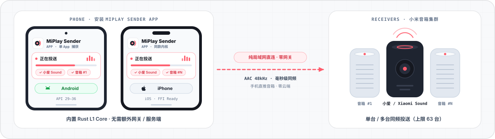
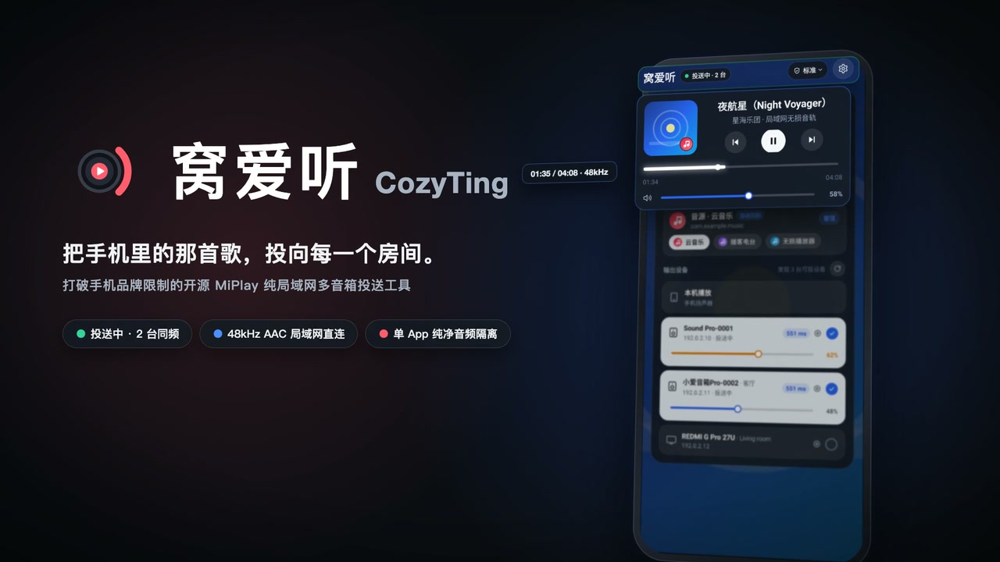
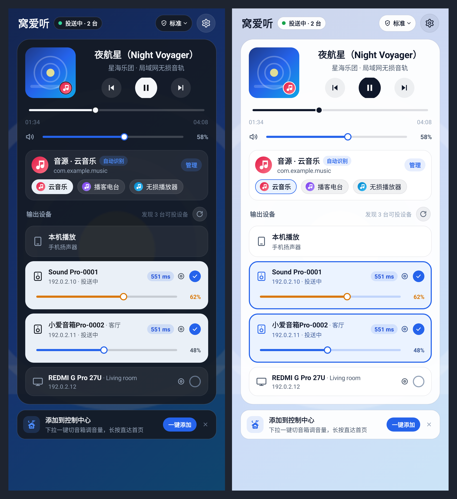
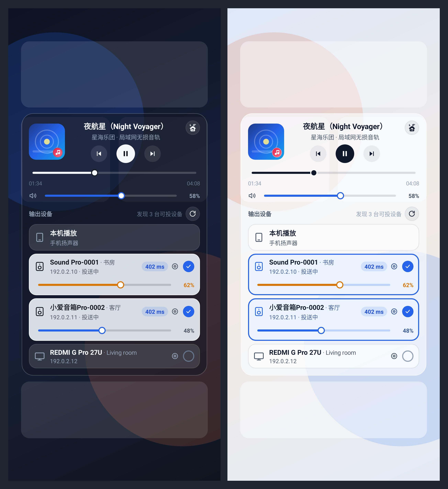
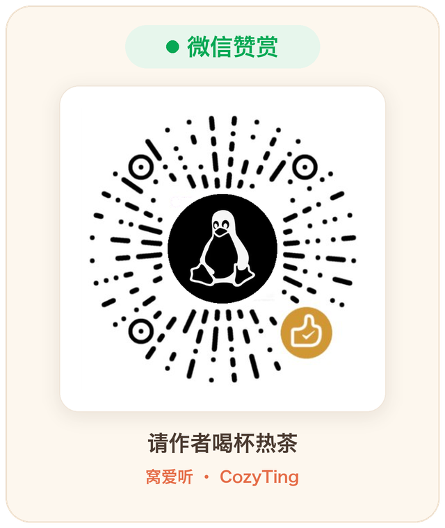

<div align="center">

<picture>
  <source media="(prefers-color-scheme: dark)" srcset="docs/assets/hero-banner-dark.svg">
  <source media="(prefers-color-scheme: light)" srcset="docs/assets/hero-banner-light.svg">
  
</picture>

# 窝爱听（CozyTing）

**回到小窝，让喜欢的歌溢满房间。**

<sub>打破手机品牌限制的开源 MiPlay 纯局域网音频投送工具：只投你选的那一个音乐 App，让多台小米 / 小爱音箱毫秒级同频合唱</sub>

<p>
  <strong>简体中文</strong> · <a href="README_EN.md">English</a> · <a href="README_JA.md">日本語</a> ·
  <a href="https://jasirvoriya.github.io/cozyting/">产品官网</a> ·
  <a href="https://jasirvoriya.github.io/cozyting/#video">演示视频</a> ·
  <a href="https://github.com/JasirVoriya/cozyting/releases">下载安装包</a> ·
  <a href="https://github.com/JasirVoriya/cozyting/issues">问题反馈</a> ·
  <a href="https://jasirvoriya.github.io/cozyting/architecture.html">交互式架构图</a> ·
  <a href="docs/COMPATIBILITY.md">设备兼容矩阵</a> ·
  <a href="CHANGELOG.md">更新日志</a> ·
  <a href="#支持窝爱听">赞赏支持</a>
</p>

<p>
  <a href="https://github.com/JasirVoriya/cozyting/actions/workflows/ci.yml"></a>
  <a href="https://github.com/JasirVoriya/cozyting/actions/workflows/pages.yml"></a>
  <a href="https://github.com/JasirVoriya/cozyting/releases"></a>
  <a href="#支持窝爱听"></a>
  <a href="LICENSE"></a>
  
  
  
  
</p>

</div>

> **窝爱听（CozyTing）是什么？**
> **窝爱听（CozyTing）** 是一款免费开源的第三方 **MiPlay 局域网音频投送客户端**（支持 Android 10+，iOS 端规划推进中）。它让**华为、三星、OPPO、vivo、一加、Pixel 以及任意 Android 手机**都能免 Root、免登录小米账号，通过家庭 Wi-Fi 局域网直接将指定音乐 App（如网易云音乐、QQ 音乐、Apple Music、Spotify、汽水音乐、小宇宙等）的声音高保真投送到家里一台或多台支持 MiPlay 协议的小米 / 小爱音箱（最多支持 63 台同频同步播放），真正做到**「只投音乐、不串杂音、零云端隐私直连」**。
>
> 🏠 **为什么叫「窝爱听」？** 忙碌一天深夜回到自己温暖的小窝，点亮一盏暖灯，打开喜欢的歌单让音乐自然流满房间、卸下疲惫——不被手机品牌生态拦在门外，也不被微信工作语音与系统通知打断。这正是「窝爱听 / CozyTing」与暖灯小屋图标的由来。
>
> 📦 **立即获取**：前往 **[GitHub Releases](https://github.com/JasirVoriya/cozyting/releases)** 直接下载 Android 安装包（APK）或桌面端诊断工具 `cozyting-cli`。
> 📑 **快速导航**：[一分钟看懂窝爱听](#-一分钟看懂窝爱听) · [解决哪些痛点](#一解决哪些痛点) · [核心功能一览](#二核心功能一览) · [界面实机一览](#三界面实机一览深色--浅色双主题) · [3 步快速上手](#四3-步快速上手普通用户) · [常见问题 FAQ](#五常见问题faq) · [技术架构与开发者指南](#六技术架构与核心实现)

---

## 🎬 一分钟看懂窝爱听

<div align="center">
  <a href="https://jasirvoriya.github.io/cozyting/#video" title="点击前往产品官网在线观看：一分钟看懂窝爱听（CozyTing）">
    
  </a>
  <p>
    <a href="https://jasirvoriya.github.io/cozyting/#video"><strong>▶ 在产品官网在线观看</strong></a> ·
    <a href="https://jasirvoriya.github.io/cozyting/assets/video/cozyting-promo.mp4">直接播放 / 下载 MP4（1280×720）</a>
  </p>
</div>

> 无旁白实机风格演示：**单 App 音频隔离**、**多台小米 / 小爱音箱毫秒级同频**、**4 档延迟热切**、**控制中心 / 通知栏秒弹悬浮控制卡**与 **Android 13+ 免 Root 无感采集**。（注：视频中界面为演示渲染，设备名称与局域网 IP 均为占位数据。）

---

## 一、解决哪些痛点？

下班回到家，只想点开手机里的歌单让小米 / 小爱音箱放满整个房间，却常常被这些琐事打断兴致：

1. **换了非小米手机，原厂「小米妙播」就用不了**：华为、三星、OPPO、vivo、一加、Pixel 等手机没有原厂妙播入口，只能退回老旧蓝牙。
2. **用蓝牙听歌体验差、还只能连 1 台音箱**：人拿着手机离开客厅就断连卡顿，音质受蓝牙压缩，更没法让客厅、卧室、书房的多台音箱同时同步放歌。
3. **整机投音 / 蓝牙极易「串音出戏」**：房间里正放着治愈的歌，微信工作语音、短视频外放、游戏音效和来电提示音全被一并广播到全屋音箱。
4. **传统投音切歌延迟高、刷视频还抢焦点**：切歌或拖动进度条要等一两秒才响应；窝在沙发上点开一条短视频，音箱里好好的音乐立刻被暂停。

### 方案对比：窝爱听（CozyTing）vs 常见投音与桥接方式

| 对比维度 | **窝爱听（CozyTing）** | DLNA / AirPlay 桥接或云端中转 | 普通蓝牙连接 | 原厂小米妙播 | 系统整机投屏 / 录屏 |
| --- | --- | --- | --- | --- | --- |
| **手机品牌限制** | ✅ **不限品牌**（任意 Android 10+；iOS 规划中） | ✅ 不限品牌 | ✅ 不限品牌 | ❌ 仅限部分小米 / Redmi 机型 | ✅ 不限品牌 |
| **是否需要 NAS / 服务器** | ✅ **无需 NAS / Docker / 电脑**，手机直装即用 | ⚠️ 多数桥接需常驻 NAS / 软路由；手机中转依赖后台保活 | ✅ 无需服务器 | ✅ 无需服务器 | ✅ 无需服务器 |
| **多音箱全屋同频同步** | ✅ **最多 63 台毫秒级同步**，播放中随时加减设备 | ⚠️ 多数仅单台推流，或需额外音频中枢配置 | ❌ 通常仅 1 台，多箱易回声不同步 | ✅ 支持多台 MiPlay 设备 | ❌ 单台或音画延迟大 |
| **单 App 隔离不串杂音** | ✅ **严格只投选定音乐 App**，任意 App 无需自带 DLNA 按钮 | ⚠️ 仅支持自带 DLNA / AirPlay 按钮的 App | ❌ 整机声音全部外放 | ✅ 支持指定媒体源 | ❌ 整机声音与画面全广播 |
| **手机刷视频不暂停音箱音乐** | ✅ **无感模式支持双区焦点隔离**（Android 13+） | ✅ 仅推流媒体 URL 时互不干扰 | ❌ 刷视频直接抢断音箱音乐 | ⚠️ 视系统版本而定 | ❌ 无法隔离 |
| **传输距离与音质** | ✅ **家庭 Wi-Fi 覆盖即不断连**（48kHz 256kbps AAC） | ✅ Wi-Fi 传输（部分方案依赖 HTTP 代理或云端下发） | ❌ 穿墙易断连、蓝牙有损压缩 | ✅ Wi-Fi 局域网传输 | ⚠️ 带宽占用高、常驻录屏红点 |
| **随时快捷控制（不离开当前 App）** | ✅ **下拉控制中心 / 通知栏秒弹磨砂悬浮卡 + 物理音量键直控** | ⚠️ 需切回对应 App 或网页管理台 | ⚠️ 仅系统蓝牙面板，无多箱独立控音 | ✅ 支持系统控制中心卡片 | ⚠️ 需进入系统投屏菜单操作 |
| **4 档延迟实时热切换** | ✅ **150ms–1000ms 四档 + 自定义 `ms` 免重连秒切** | ❌ 不可调 | ❌ 不可调 | ❌ 不可调 | ❌ 不可调 |
| **账号、云端与开源隐私** | ✅ **纯局域网原生 MiPlay、免登录小米账号、零云端、AGPL-3.0 开源** | ❌ 多数需登录小米账号 / 调用小米云端 API | ✅ 本地直连（闭源） | ❌ 绑定小米账号与系统生态 | ⚠️ 依厂商服务而定 |

---

## 二、核心功能一览

### 1. 打破品牌壁垒，局域网开箱直连小米 / 小爱音箱
- 只要手机和音箱连在同一个 Wi-Fi 局域网下，打开窝爱听即可自动扫描发现家里的小米音箱、小爱音箱及支持 MiPlay 的设备，**无需登录小米账号、不经过任何云端服务器**。
- 自动过滤局域网内不支持 MiPlay 的杂项设备，只展示真正能投送的音箱，并直接读取展示音箱的真实名称与所属房间名。

### 2. 只投你选的那一个音乐 App，微信语音与通知绝不串音
- 严格遵循「单 App 音频隔离」原则：你指定投送网易云音乐或 Apple Music，音箱就**只播这一个 App 的声音**，绝不静默退化为全系统录屏或麦克风收音。
- 收到微信语音、刷到带背景音的信息流、系统提示音都不会广播到客厅音箱；切歌静音间隙也不会出现手机与音箱短暂「双出声」。

### 3. 内置无线调试「无感模式」（Android 13+）：免 Root、免电脑、免 Shizuku
- **标准投屏模式**兼容 Android 10+ 所有机型，零配置开箱即用；
- 如果你是 **Android 13+** 用户，可在 App 内跟随 **4 步内置无线调试向导**完成一次 6 位配对码配对（纯手机本机直连，无需 Root、无需电脑、无需额外安装 Shizuku），即可解锁接近原厂体验的**无感采集模式**：
  - **告别反复弹窗**：投送不再每次弹出「开始录制或投射」系统确认框，也不常驻「正在投屏」系统提示；
  - **真·单 App 本机静音**：仅静音正在投送的那一个音乐 App 的手机本地输出，手机里其他 App 照常通过手机扬声器发声；
  - **刷视频与音箱放歌互不打扰（双区音频焦点隔离）**：客厅音箱继续放歌的同时，手机照常刷抖音、看 B 站、听微信语音，互不暂停、互不抢焦点。

### 4. 全屋多音箱毫秒级同频合唱，随时加减不中断
- 在主界面直接勾选一台或多台音箱（协议层最多支持 **63 台**），即可让客厅、卧室、餐厅的音箱毫秒级同频同步播放同一首歌。
- 每台音箱独立显示**房间名、实时播放延迟（`ms`）与独立音量条**；听歌途中想给书房加一台音箱，或关闭卧室音箱，直接勾选/取消勾选即可，**全程不断歌、不卡顿**。

### 5. 下拉控制中心 & 通知栏秒弹悬浮控制卡，像系统原生一样随手控
- **控制中心快捷磁贴（Android 10–16 全兼容）**：将「窝爱听」加入系统下拉控制中心，**轻点磁贴**即收起系统栏并在当前 App 上方直接弹出通透磨砂悬浮控制卡（Android 12+ 启用系统窗口背景毛玻璃），**长按磁贴**直达 App 首页；Android 13+ 支持在 App 首页或设置页**一键添加**至控制中心，Android 10–12 提供 3 步引导。
- **通知栏直达 · 零打断体验**：投送中下拉轻点常驻通知正文或「设备与音量」按钮同样秒弹同一张悬浮卡；独立透明任务栈、不进最近任务，点空白处或返回键即关闭，无缝回到你正在刷的 App。
- **小卡片全功能 + 物理音量键直控**：悬浮卡 1:1 集成正在播放切歌/进度条、多音箱随时加减、单音箱行内独立音量与「恢复上次」音箱组合一键开播；打开主界面或悬浮卡时，直接按手机侧边**物理音量 `+/-` 键**即可顺滑调节投送总音量（不弹系统音量条，保留高音量二次确认保护）。

### 6. 4 档播放延迟一键热切换，稳听歌与跟手切歌兼得
- 顶部状态栏内置延迟档位胶囊，投送过程中**无需断开重连**即可实时热切换 4 档缓冲延迟（也支持在设置中自定义 `ms`）：
  - **标准（5GHz 800ms / 2.4GHz 1000ms）**：官方默认基线，抗穿墙弱网抖动能力最强，适合多音箱长时间稳定听歌；
  - **均衡（400ms）**：日常主力档，双音箱同步稳定，切歌/暂停响应较默认快约一倍；
  - **低延迟（250ms）**：单音箱 5GHz 强信号主力档，切歌与拖动进度条非常跟手；
  - **极速（150ms）**：实验性极低缓冲，适合同房间 5GHz 单音箱追求极致响应的场景。

### 7. 常用音源自动跟随 + 现代双主题界面
- **常用音源管理**：自由增删常用音乐 / 播客 App、长按拖动排序，并为每个 App 独立设置「自动识别」开关——切回你常用的音乐 App 开始播放，窝爱听即可自动识别音源（投送中绝不误切打断）。
- **专辑氛围界面 & 三态主题**：主界面根据当前播放歌曲的专辑封面呈现克制的柔和氛围底色，支持深色 / 浅色 / 跟随系统三态切换，点击封面右下角 App 角标可一键跳回对应音乐软件。
- **可控的透明更新**：默认每日静默检查公开分发仓的新版本，展示跨版本聚合更新日志并通过 SHA-256 与签名校验后安装；如需绝对零外网请求，可在设置中一键关闭。

---

## 三、界面实机一览（深色 / 浅色双主题）

> 以下界面由 Android 真实视图代码直接渲染输出，采用匿名示例歌单与示例局域网地址，直观展示日常多音箱投送与双主题体验。





> 📸 **完整主界面 + 随手悬浮控制卡双形态**：下拉控制中心或轻点通知栏即可在任意 App 上方弹出悬浮控制卡（点空白处即关，不切出当前应用）。前往 **[产品官网 · 完整界面实机画廊（9 组深浅双主题截图）](https://jasirvoriya.github.io/cozyting/#screenshots)** 查看 4 档延迟热切、常用音源管理、无线调试无感向导与安全更新弹窗。

---

## 四、3 步快速上手（普通用户）

1. **下载并安装 Android 应用**
   - 要求：**Android 10（API 29）及以上**（`arm64-v8a` 设备）。
   - 前往 **[GitHub Releases（cozyting）](https://github.com/JasirVoriya/cozyting/releases)** 下载最新的 `cozyting-*-arm64-v8a.apk` 安装到手机。
2. **连接同一家庭 Wi-Fi，自动发现音箱**
   - 确保手机与小米 / 小爱音箱处于同一局域网（同路由器 Wi-Fi）。
   - 打开窝爱听，几秒内即可在「输出设备」列表看到局域网内支持 MiPlay 的音箱。
3. **选择音乐 App 与音箱，一键开播**
   - 点击顶部音源卡片选择想投送的音乐 App（或先在音乐 App 里开始播放，窝爱听自动识别），勾选一台或多台音箱即可同频播放。
   - **采集模式怎么选？**
     - **标准投屏模式（默认）**：兼容 Android 10–16+ 所有机型，无需任何额外配置，开箱即用；
     - **无感模式（Android 13+ 推荐）**：进入「设置 → 采集引擎 → 无感模式（无线调试）」，按 4 步向导完成一次 6 位配对码配对，即可免去投屏弹窗并获得真·单 App 静音与双区音频焦点隔离。
   - **💡 日常顺手小技巧（强烈推荐）**：点击首页底部的「添加到控制中心」轻引导条（或进入「设置 → 控制中心快捷磁贴」一键添加，Android 13+ 支持一键确认）。之后听歌途中想调音量或加减音箱，**下拉点磁贴或轻点投送通知栏即可秒弹悬浮控制卡**，长按磁贴可直达 App 首页。

---

## 五、常见问题（FAQ）

### Q1：非小米手机（华为、三星、OPPO、vivo、一加、Pixel 等）能用窝爱听投音到小爱音箱吗？
**可以。** 只要手机系统为 **Android 10 及以上**且与小爱 / 小米音箱连在同一 Wi-Fi 下，就可以直接通过局域网 MiPlay 协议投送音乐，无需小米手机，也无需登录小米账号。不同品牌 ROM 的已实测状态可在 [设备兼容矩阵（COMPATIBILITY.md）](docs/COMPATIBILITY.md) 查看。

### Q2：窝爱听和常见的「NAS / Docker 搭 DLNA / AirPlay 桥接」或「手机 DLNA 中转（小米云 API）」方案有什么区别？
市面上把非小米手机音乐投到小爱音箱的开源方案，大多走 **DLNA / AirPlay 桥接**（需常驻 NAS、软路由或树莓派）或 **手机端 DLNA 中转**（把指令翻译成小米云端 API 下发），普遍需要**登录小米账号**、受限于音乐 App 是否自带 DLNA 按钮，且较难实现多台音箱毫秒级同频。**窝爱听（CozyTing）**直接走**纯局域网原生 MiPlay 协议**：
- **无需 NAS / 服务器、免 Root**：手机装一个 APK 即可开箱直连；
- **零云端、免登录小米账号**：不依赖小米云 API，断外网纯局域网也能用；
- **不限音乐 App 是否支持 DLNA**：网易云音乐、QQ 音乐、Apple Music、Spotify、汽水音乐、小宇宙等只要允许系统音频捕获即可单 App 隔离投送；
- **原生多房间同频与低延迟**：支持最多 63 台支持 MiPlay 的小米 / 小爱音箱毫秒级同频同步，并支持 4 档延迟实时热切换。

### Q3：窝爱听和直接连小爱音箱蓝牙有什么区别？
蓝牙通常只能连 1 台音箱、穿墙易断连、存在蓝牙音频压缩，且手机里的所有声音（微信语音、短视频、通知）都会全部从音箱外放。窝爱听走 **家庭 Wi-Fi 局域网**，支持**多台音箱毫秒级同频合唱**、**48kHz 256kbps AAC 高质量直传**，并且**只投你选的那一个音乐 App**，离开客厅只要有 Wi-Fi 就不会断。

### Q4：音箱放歌时，我在手机上刷抖音、看 B 站或听微信语音，会串音或把音箱音乐暂停吗？
**不会串音。** 窝爱听只捕获你选定的音乐 App 的音频流，微信语音、短视频和系统提示音都不会发送到音箱。在 **Android 13+ 开启「无感模式（无线调试）」**后，窝爱听还会启用**双区音频焦点隔离**与**真·单 App 本机静音**——音箱继续正常放歌，你在手机上照常刷视频、听语音，互不暂停、互不抢声。在普通标准模式下，由于 Android 普通权限无法单独静音单一 App，你可以在设置中选择「全局媒体静音（默认）」或「保留本机出声」。

### Q5：开启「无感模式」需要 Root 手机、连电脑，或者安装 Shizuku 吗？
**都不需要。** 窝爱听在 App 内部直接实现了轻量无线调试客户端，仅需手机本身在开发者选项里开启一次「无线调试」并输入 6 位配对码即可完成（约 30 秒），全程不 Root、不连电脑、不依赖任何第三方提权 App。如果不想开启无线调试，直接使用默认的「标准投屏模式」也完全可以正常投送。

### Q6：投送时不想离开正在刷的 App，怎么快速调音箱音量或加减音箱？
**下拉控制中心或轻点通知栏即可秒弹悬浮控制卡。** 把「窝爱听」添加到系统控制中心快捷磁贴后（Android 13+ 可在 App 首页或设置页一键添加），在任意应用里**轻点磁贴**或**点击投送常驻通知 /「设备与音量」按钮**，都会直接在当前画面上方弹出磨砂悬浮控制卡：可随时切歌、勾选/取消音箱、调单台独立音量或按手机侧边**物理音量键**直控总音量；点空白处或返回键即关闭，不会进入最近任务。长按控制中心磁贴可直接打开 App 首页。

### Q7：支持哪些小米 / 小爱音箱和音乐 App？
- **音箱端**：支持声明局域网 MiPlay 能力的小米音箱 / 小爱音箱系列及部分小米电视（具体实测型号与已知固件差异如 LX06 晚加入限制，请查阅 [设备兼容矩阵](docs/COMPATIBILITY.md)）。
- **音源 App**：支持主流允许系统音频捕获的音乐 / 播客 App（如网易云音乐、QQ 音乐、Apple Music、Spotify、汽水音乐、酷狗、小宇宙等）。注意：若极少数第三方 App 显式声明 `allowAudioPlaybackCapture="false"` 禁止捕获，窝爱听尊重系统规则，不会尝试绕过。

### Q8：窝爱听会收集隐私、上传音频，或者需要登录小米账号吗？
**不会。** 音频投送与设备发现 100% 在你的本地家庭局域网内完成，**零云端服务器、零账号登录、零音频上传、零使用统计**。唯一的外网行为是每 24 小时向公开静态版本清单 `update.json` 发起一次匿名只读 HTTPS 检查（支持 `ETag 304`、零 Cookie、零设备/局域网参数，且强制 SHA-256 与 APK 签名校验），离线环境下亦不影响全部局域网投送功能。

### Q9：支持 iPhone / iPad（iOS）吗？
**底层核心已就绪，iOS 客户端正在规划推进中。** 窝爱听的共享 Rust 协议与同步核心已经提供完整的 iOS C ABI（`cozyting_core.h`）与 `XCFramework` 打包脚本，跨端设计规范（`design/`）亦已同步；原生 SwiftUI + ReplayKit 客户端设计详见 [docs/IOS_CLIENT_DESIGN.md](docs/IOS_CLIENT_DESIGN.md)。

---
---

> 👇 **以下章节面向开发者、协议研究者与贡献者**，详细介绍窝爱听的底层 Rust 引擎、跨端三层架构、实时线程模型、CLI 诊断工具与本地构建测试流程。

## 六、技术架构与核心实现

### 1. 核心技术底座

- **严格单 UID 捕获校验（Fail-Closed）**：标准模式下通过 Android `AudioPlaybackCapture` 白名单捕获单 UID，并在启动前实时校验目标包同用户、非共享 UID 与 SHA-256 签名，严禁静默退化为全系统录屏或麦克风采集；内置 `PcmProbe` 6 拍有声验证锁定，消除切歌间隙手机/音箱短暂双出声。
- **内置无线调试 `AudioPolicy` 无感引擎（Android 13+）**：通过本机无线 ADB（mDNS + SPAKE2 / TLS 1.3）拉起同应用 `uid=2000` 辅助进程，绕开 `MediaProjection` 弹窗与投屏提示；采用本机环回 `127.0.0.1` + 一次性 256-bit Token 通信，在单一 `AudioPolicy` 上同时挂载单 App `AudioMix` 与 `AudioPolicyFocusListener` 实现双区音频焦点隔离。
- **63 台音箱确定性毫秒级同步**：L1 纯 Rust 核心（`miplay-core`）完全基于确定性实时线程与有界通道（**零异步运行时**），通过 `EPOCH` 单调时基、`UDP 40B TimerServer` 时钟主与 `OffsetBarrier` 14 AU 预读对齐实现全组同频，并支持投送中 `TIME_OFFSET` 热重锚切档、随时加减音箱与慢端单端剔除。
- **双认证控制链路严格隔离**：完整实现局域网 MiPlay 发现与 TCP `8899` 控制协议，严格隔离 Legacy（`MD5 + HMAC-SHA1`）与 Safety（`OPack + 双向 HMAC + 链式 AES-128-CBC`）两条认证链路。
- **跨端共享 L1 核心 + 只读诊断 CLI**：Android（Kotlin + 16KB 页对齐 JNI `.so`）与规划中的 iOS（Swift + C11 `cozyting_core.h` / `.xcframework`）共用 100% 平台无关的 L1 Rust 核心与 `design/` 跨端视觉规范；桌面端 `cozyting-cli inspect` 仅发 `GET_*` 并以 `TCP shutdown` 退出，绝不发 `CLOSE` 打断正在播放的音乐。

### 2. 架构流程图与模块总览

> 🧭 **查看完整技术流程图、数据流向与线程模型**：
> - **在线交互式架构浏览器**：访问 **[https://jasirvoriya.github.io/cozyting/architecture.html](https://jasirvoriya.github.io/cozyting/architecture.html)**（或打开本地零依赖 [`docs/architecture.html`](docs/architecture.html)），点击任意模块即可高亮追踪其 **↑ 上游来源 / ↓ 下流消费者**，并查看跨端三层架构、四条正交数据流向与单进程实时线程模型。
> - **全仓源码深度手册**：查阅 **[docs/ARCHITECTURE.md](docs/ARCHITECTURE.md)**（含 41 个 Android 源码、24 个 Rust 核心模块、19 组 JVM 契约单测与 6 阶段生命周期不变量详表）。

### 3. 目录结构

```text
cozyting/
├── core/               # [L1 公共核心层] 纯 Rust 协议、多箱同步引擎、并发协调器 (engine)、设备目录与更新裁决
│   ├── include/        #   [FFI] iOS / C11 头文件 (cozyting_core.h) 与 module.modulemap
│   └── src/            #   24 个核心模块（含 Android JNI ffi.rs 与 iOS C ABI ffi_c.rs）
├── design/             # [L3 跨端共享设计层] 明暗双主题 tokens.json、20 枚 24x24 矢量图标与 UI_SPEC.md
├── android/            # [L2+L3 Android 端] Kotlin 原生客户端 (:app standard/acceptance) 与三 UID 隔离测试音源 (:testtones)
├── cli/                # [工程支撑] 独立终端工具 cozyting-cli（discover / 只读 inspect / 投送与故障注入调试）
├── scripts/            # [构建流水线] Android debug/release 构建、iOS XCFramework 打包与 16KB 页对齐/签名验收脚本
└── docs/               # [文档与官网] 产品官网 (index.html)、交互式架构图 (architecture.html)、深度手册、兼容矩阵与 GEO 索引 (llms.txt)
```

> 完整的 65+ 源码文件与 19 个 JVM 单测文件职责字典见 **[docs/ARCHITECTURE.md](docs/ARCHITECTURE.md#三全仓分层模块与文件职责字典按-l3--l2--ffi--l1--工程支撑展开)**。

---

## 七、开发者指南：CLI 诊断 · 本地构建 · 测试

### 1. 使用 `cozyting-cli` 只读诊断局域网音箱

可在 **[GitHub Releases](https://github.com/JasirVoriya/cozyting/releases)** 直接下载预编译三端 `cozyting-cli`，或在源码仓库本地运行：

```sh
# 扫描局域网 MiPlay / 小爱音箱（输出 6 列 TSV：IP、名称、型号、MiPlay 能力声明等）
cargo run --release -p cozyting-cli -- discover

# 只读查询指定音箱状态（仅发 GET_* 并以 TCP shutdown 退出，不发 CLOSE，不打断正在播放的音乐）
cargo run --release -p cozyting-cli -- inspect <音箱IP> --auth legacy
```

### 2. 本地构建（Android APK & iOS XCFramework）

环境依赖：JDK 17+、Android SDK（`platforms;android-36` / `build-tools;36.0.0` / NDK）、Rust ≥ 1.75、`aarch64-linux-android`、`cargo-ndk`（构建 iOS 另需 macOS + Xcode）。

```sh
export ANDROID_HOME=/path/to/android-sdk
export ANDROID_NDK_HOME=$ANDROID_HOME/ndk/<version>
rustup target add aarch64-linux-android
cargo install cargo-ndk --locked

# Android Debug 一键构建（串联 cargo test + 16KB 页对齐 .so + Gradle 单测与 APK）：
./scripts/build-debug.sh

# Android Release 正式签名构建（通过 MIPLAY_RELEASE_* 或未跟踪的 android/keystore.properties 注入签名）：
./scripts/build-release.sh

# iOS 静态库与 CozyTingCore.xcframework 打包（macOS + Xcode）：
./scripts/build-ios-xcframework.sh
```

### 3. 运行自动化测试与静态门禁

```sh
# 1. L1 Rust 协议、媒体打包、Engine 协调器、设备目录与更新解析单测
cargo test --workspace

# 2. FFI iOS C ABI 头文件 C11 严格语法校验
clang -std=c11 -Wall -Wextra -Werror -fsyntax-only core/include/cozyting_core.h

# 3. L2/L3 Android JVM 契约单测与 NewApi Fatal Lint
cd android && ./gradlew --no-daemon test lintStandardDebug
```

---

## 八、诚实工程边界与延伸文档

本项目坚持**只声明有代码或实机证据支撑的能力**，明确不承诺以下边界：

- **不绕过第三方捕获限制**：显式声明 `allowAudioPlaybackCapture="false"` 的第三方 App 无法捕获。
- **区分标准模式与无感模式的静音边界**：未开启无感模式（普通应用权限）时，Android 公开 API 不支持单独静音某一个第三方 App 而不影响 `STREAM_MUSIC`，因此提供「全局媒体静音（默认）」与「保留本机出声」两种显式策略；真·单 App 本机静音与双区音频焦点隔离需在 Android 13+ 启用无感模式，且实际路由效果以具体机型 ROM 实测为准。
- **不把编译通过等同于全机型兼容**：各厂商后台冻结策略（如 HyperOS Greeze）及部分音箱固件协议差异（如 LX06 晚加入扩组，见 [`docs/LX06_V8_POSTMORTEM.md`](docs/LX06_V8_POSTMORTEM.md)）需按机型实测核验。

📚 **延伸文档索引**：
- [产品官网（GitHub Pages）](https://jasirvoriya.github.io/cozyting/) · [在线交互式架构浏览器](https://jasirvoriya.github.io/cozyting/architecture.html)（[本地 HTML](docs/architecture.html)） · [AI / LLM 索引（llms.txt）](docs/llms.txt)
- [架构与全仓源码深度手册](docs/ARCHITECTURE.md) · [音箱与发送端设备兼容矩阵](docs/COMPATIBILITY.md) · [未测限制与已知缺口](docs/LIMITATIONS.md)
- [Android 内置无线调试无感采集方案](docs/ANDROID_WIRELESS_DEBUG_CAPTURE_DESIGN.md) · [iOS 客户端设计方案（规划）](docs/IOS_CLIENT_DESIGN.md) · [局域网 AirPlay 2 网关设计方案（保留）](docs/AIRPLAY_BRIDGE_DESIGN.md)
- [更新日志 (CHANGELOG)](CHANGELOG.md) · [参与贡献 (CONTRIBUTING)](CONTRIBUTING.md) · [安全策略 (SECURITY)](SECURITY.md) · [本机静音边界](docs/LOCAL_MUTE.md) · [延迟预算模型](docs/LATENCY_BUDGET.md)

---

## 九、许可与免责声明

- **开源许可证**：本项目采用 **[GNU Affero General Public License v3.0 (AGPL-3.0-only)](LICENSE)** 开源发布。
- **非官方与互操作性声明**：本项目为独立的第三方开源客户端实现，仅用于局域网设备互操作性与音频投送技术研究。本项目与小米集团（Xiaomi）及其关联公司没有任何隶属、授权、认可或合作关系。文中所提及的产品名称、协议名称或商标均归其各自所有者所有。
- **隐私与网络边界**：仅捕获用户授权的音频流，不采集屏幕图像或麦克风，音频投送全程在本地局域网直连运行；应用内置的公开版本更新检测仅每 24 小时匿名只读拉取一次公开静态清单（强制 HTTPS + SHA-256 与签名校验，零遥测、不上传任何设备或局域网数据）。

### 支持窝爱听

窝爱听（CozyTing）的所有功能**永久免费开源、纯局域网零云端**，不会设置任何付费墙或特权功能。如果它陪你度过了几个放松的夜晚、或者帮你重新盘活了家里的小爱音箱，欢迎随手点个 **Star**，或自愿请作者喝杯热茶：

- **支付宝直达**：[手机端点击直接打开支付宝](https://qr.alipay.com/fkx13666yfftru6suyvjk59)

<div align="center">
  <table>
    <tr>
      <td align="center" width="260">
        
      </td>
      <td align="center" width="260">
        
      </td>
    </tr>
  </table>
</div>

### 贡献者致谢

感谢每一位提交代码、实测设备兼容或反馈建议的贡献者！

<a href="https://github.com/JasirVoriya/cozyting/graphs/contributors">
  
</a>
