<div align="center">

<picture>
  <source media="(prefers-color-scheme: dark)" srcset="docs/assets/logo-dark.svg">
  <source media="(prefers-color-scheme: light)" srcset="docs/assets/logo.svg">
  
</picture>

# MiPlay 发送端（纯局域网）

**跨端局域网音频捕获与投送（Android & iOS）· 零云端纯局域网 · 多音箱毫秒级同频同步**

<p>
  <strong>简体中文</strong> · <a href="README_EN.md">English</a> ·
  <a href="https://jasirvoriya.github.io/miplay-sender/">在线交互式架构图</a> ·
  <a href="docs/COMPATIBILITY.md">设备兼容矩阵</a> ·
  <a href="CHANGELOG.md">更新日志</a> ·
  <a href="CONTRIBUTING.md">参与贡献</a>
</p>

<p>
  <a href="https://github.com/JasirVoriya/miplay-sender/actions/workflows/ci.yml"></a>
  <a href="https://github.com/JasirVoriya/miplay-sender/releases"></a>
  <a href="LICENSE"></a>
  
  
  
  
</p>

<p>
  
  
  
  
  
</p>

<p>
  
  
  
</p>

<p>
  <a href="#核心亮点">核心亮点</a> ·
  <a href="#技术栈">技术栈</a> ·
  <a href="#目录结构">目录结构</a> ·
  <a href="#许可与免责声明">许可与声明</a> ·
  <a href="#功能">功能清单</a> ·
  <a href="#架构总览">架构总览</a> ·
  <a href="#构建">构建指南</a>
</p>

</div>

## 核心亮点

| 维度 | 核心能力 |
| --- | --- |
| **🎯 严格单 App 音频隔离** | Android 端基于 `AudioPlaybackCapture` 强制单 UID + `USAGE_MEDIA/GAME/UNKNOWN` 白名单，启动前校验包可见性、同用户、非共享 UID 与签名摘要（任一不满足即 **fail-closed** 拒绝），绝不静默退化为全系统录屏或采集麦克风。 |
| **🔊 多音箱毫秒级同频同步** | L1 Rust 引擎内置单调时基 `EPOCH`、UDP 40B `TimerServer` 时钟主、建连期 `OffsetBarrier` 冲刷积压与预读 14 AU 对齐，单会话最多并发同步 **63 台**局域网音箱，支持运行期动态加减箱与 15s 看门狗指数退避重连。 |
| **🔐 纯局域网与双认证隔离** | 全程本地直连、零云端 API、零账号登录；严格隔离 Legacy（`MD5 + HMAC-SHA1`）与 Safety（`OPack + 双向 HMAC + 链式 AES-128-CBC`）两条控制认证链路。 |
| **🧩 跨端客户端 + CLI 交付** | 共用同一套 L1 Rust 核心（`engine` / `device_catalog`）与 `design/` 跨端设计规范：提供 Android 10–16 明暗双主题原生客户端、iOS C ABI / XCFramework 跨语言桥接（SwiftUI 客户端规划中），以及独立桌面终端工具 `miplay-cli`（支持只读 `inspect`）。 |

## 技术栈

| 分层 | 技术选型 / 协议 / 关键依赖 | 用途与工程约束 |
| --- | --- | --- |
| **L3 · 原生表现与共享设计层** | `design/`（`tokens.json` · 24×24 SVG · `UI_SPEC.md`）· Android `Kotlin 2.0.21`（规划 iOS `SwiftUI`） | 跨端统一设计语义；Android 纯代码构建深色/浅色/跟随系统三态 UI，API 31+ `RenderEffect` 毛玻璃、API 29–30 压暗降级；不申请 `QUERY_ALL_PACKAGES` |
| **L2 · 平台系统接口层** | Android `AudioPlaybackCapture` + `MediaCodec` + `CastService` FGS（规划 iOS `ReplayKit` + `AudioToolbox`） | `MAX_PRIORITY` 采集编码线程（48kHz AAC-LC 256kbps）；RMS + Goertzel（1kHz/2kHz）数字域探针驱动静音锁定与隔离验收 |
| **FFI · 跨语言原生桥接层** | Android `JNI` (`jni 0.21`, `cargo-ndk`, **16KB ELF 页对齐**) · iOS `C ABI` (`ffi_c.rs`, `miplay_core.h`, `.xcframework`) | 薄转发层：单进程零 IPC 拷贝；`FEED_QUEUE_AUS = 96`（≈2s）有界通道，`stop()` 先 `drop(feed)` 消除停播死锁 |
| **L1 · Rust 协议与同步核心层** | `Rust 2021 (≥1.75)` · `LTO` · **零异步运行时**（纯 `std::thread` + 有界 `sync_channel`） | 平台无关：`engine` 多箱并发协调器、`device_catalog` 路由状态机、`media-clock`（21.333ms 节拍）+ `supervisor` + 每台音箱独立 5 线程 |
| **L1 · 网络发现与加密协议** | `mDNS` (`224.0.0.251:5353`) · `TCP 8899` · `WFD RTSP` · `UDP TimerServer` · RustCrypto (`aes`/`cbc`/`hmac`/`sha1`/`sha2`/`md-5`) | 优先融合 `_mi-connect` (`apps=[5]`) 与 `_lyra-mdns`；纯 Rust 实现无 OpenSSL 原生依赖 |
| **L1 · 流媒体封装** | `ADTS (7B)` → `PES (0xC0)` → `MPEG-TS (188B + CRC32)` → `RTP (PT=33)` → `$+24bit` TCP 线帧 | 每台接收端维护独立 `Packetizer`（独立 RTP 序号与 TS 连续计数），共享同源 90kHz PTS / 27MHz PCR |
| **工程支撑 · 构建、测试与合规** | `Gradle 8.11.1` · `AGP 8.7.3` · `standard` / `acceptance` 双变体 · `NewApi` Fatal Lint | 19 个 JVM 契约单测文件 + `cargo test` (63 项) + C11 头文件校验 + `:testtones` 三 UID 声道隔离验收包；全仓 `AGPL-3.0-only` |

## 目录结构

```text
miplay-sender/
├── core/                         # [L1 公共核心层] 纯 Rust 协议与多箱同步引擎（Android / iOS / CLI 全平台共享）
│   ├── Cargo.toml                #   支持 rlib / cdylib(.so) / staticlib(.xcframework)
│   ├── include/                  #   面向 iOS Swift 的 C11 头文件 (miplay_core.h) 与 module.modulemap
│   └── src/                      #   核心源码（以下展开最关键模块）
│       ├── engine.rs             #     跨端会话句柄表与多箱并发协调器
│       ├── device_catalog.rs     #     设备发现分类、过滤、缓存合并与路由互斥状态机
│       ├── ffi.rs                #     [FFI] Android JNI 薄桥接插头
│       ├── ffi_c.rs              #     [FFI] iOS / C ABI 薄桥接插头
│       ├── discovery.rs          #     mDNS 局域网设备发现与能力解析
│       ├── control.rs            #     TCP 8899 控制通道、心跳与音量/暂停恢复
│       ├── auth/                 #     双认证隔离（legacy 明文 / safety 加密）
│       ├── rtsp.rs               #     WFD 反向 RTSP 协商与 TIME_OFFSET 下发
│       ├── clock_sync.rs         #     UDP TimerServer 时钟主（与 timeline 同源）
│       ├── session.rs            #     多音箱并发会话、建连对齐与断线重连（最多 63 台）
│       └── media/                #     流媒体封装（ADTS -> MPEG-TS -> RTP）
├── design/                       # [L3 跨端共享设计层] Android 与 iOS 共用的 tokens.json、24x24 矢量图标与 UI_SPEC.md
├── cli/                          # 独立终端工具 miplay-cli（发现 / 只读 inspect / 投送调试）
│   └── src/                      #   CLI 命令入口（main.rs）
├── android/                      # [L2+L3 Android 端] Kotlin 原生客户端与测试工程
│   ├── app/                      #   主应用模块（standard 正式包 / acceptance 验收包）
│   │   ├── build.gradle.kts      #     变体、签名注入、NewApi Fatal Lint 与依赖配置
│   │   └── src/
│   │       ├── main/             #     正式源码（L3 UI / ui/* · L2 CastService / capture/* / cast/* / compat/*）
│   │       ├── acceptance/       #     验收变体叠加清单与本地音频过滤探针入口
│   │       └── test/             #     19 个 JVM 单元与契约回归测试文件
│   └── testtones/                #   三 UID 声道隔离验收音源 App（1kHz / 2kHz / deny）
├── scripts/                      # 构建、签名与校验脚本
│   ├── build-debug.sh            #   Rust 测试 + 16KB 对齐 cargo-ndk + Gradle Debug
│   ├── build-release.sh          #   正式签名 Release APK 与校验和流水线
│   ├── build-ios-xcframework.sh  #   iOS 静态库与 MiPlayCore.xcframework 打包脚本
│   └── verify-acceptance-apk.sh  #   验收包 16KB 对齐、签名与清单隔离校验
├── docs/                         # 架构可视化、专项文档、兼容矩阵、修复日志与需求排期
│   ├── architecture.html         #   零依赖本地交互式架构浏览器
│   ├── assets/                   #   Logo、社交卡片与架构动效 SVG 图集
│   ├── COMPATIBILITY.md          #   音箱与发送端设备兼容矩阵
│   ├── superpowers/              #   专题设计规格（specs）与实施计划（plans）
│   ├── 待修复需求.md             #   当前需求排期与验收条件（含 #6 UI / #7 下沉）
│   └── 修复日志.md               #   已合入修复的证据与测试记录
├── Cargo.toml                    # Rust Workspace 总配置（core + cli）
├── LICENSE                       # AGPL-3.0-only 开源许可证
└── README.md                     # 项目总览、架构说明与构建指南
```

## 许可与免责声明

- **开源许可证**：本项目采用 **[GNU Affero General Public License v3.0 (AGPL-3.0-only)](LICENSE)** 开源发布。
- **非官方与互操作性声明**：本项目为独立的第三方开源客户端实现，仅用于局域网设备互操作性与音频投送技术研究。本项目与小米集团（Xiaomi）及其关联公司没有任何隶属、授权、认可或合作关系。文中所提及的产品名称、协议名称或商标均归其各自所有者所有。
- **隐私与边界**：仅捕获用户授权的声音流，不采集屏幕图像或麦克风，不连接任何云端 API，仅在用户本地局域网内按选定目标投送音频。

## 功能

- **局域网多箱投送**：mDNS 自动发现、多选分组、暂停恢复、运行期动态加入/移除、音量同步、Legacy/Safety 认证、断线退避重连与前台通知
- **主界面与主题**：支持 **深色 / 浅色 / 跟随系统** 三档切换（基于跨端 `design/` 规范）；本机与多选音箱互斥切换、MediaSession 正在播放卡片与独立设置页
- **延迟行内展示**：投送中在每台活跃设备行内原位显示估计 E2E **整数 `ms`**（连接/采样缺值显示加载转圈，停止/失败/未选中时隐藏）；定义见 `docs/LATENCY_BUDGET.md`（估计值≠协议 RTT 或声学实测）
- **本机静音策略**：提供 `GLOBAL_STREAM_MUTE`（默认全局媒体静音 + 6 拍有声验证锁定防切歌双出声）与 `KEEP_LOCAL_OUTPUT`（保留本机出声）双策略，见 `docs/LOCAL_MUTE.md`（无探针通过绝不虚假宣称已静音）
- **只读诊断 CLI**：`miplay-cli inspect <IP> --auth legacy`（仅 `GET_*` + TCP shutdown；**旧 `probe` 会发协议 `CLOSE`，不是无副作用只读**）
- **已知协议研究边界**：晚加入扩组 / Safety / Open-poll 等假设见 `docs/LX06_V8_POSTMORTEM.md`（**不宣称 LX06 已修好**）
- **Android 端系统约束**：
  - 音源：**测试静音** 或 **选定 App 音频**（`AudioPlaybackCapture` + 严格单 UID + usage 白名单过滤）
  - 兼容范围：minSdk **29**（Android 10+）～ target/compileSdk **36**；`arm64-v8a`（16KB ELF 页对齐）
  - 毛玻璃：API 31+ 使用 `RenderEffect`，API 29–30 自动降级为压暗叠色（见 `BlurCompat`）
  - 权限最小化：不申请 `QUERY_ALL_PACKAGES`；不采集麦克风（`RECORD_AUDIO` 仅用于播放捕获）；`MediaProjection` **每次会话重新授权**，切换目标立即停止旧会话

## 架构总览

本项目采用统一的 **L1–L3 跨端三层架构**：
- **L1 · 公共核心层（Rust `core/`）**：全平台共享协议、认证、多箱时钟同步、流媒体打包、多箱并发协调器（`engine.rs`）与设备目录/路由互斥状态机（`device_catalog.rs`）。
- **FFI · 跨语言薄插头层**：Android 走 JNI（`NativeBridge.kt` ⇄ `core/src/ffi.rs`），iOS 走 C ABI（`miplay_core.h` ⇄ `core/src/ffi_c.rs`），仅做参数与句柄转发。
- **L2 · 平台系统接口层** 与 **L3 · 原生表现及共享设计层**：由 Android（已实现）与 iOS（C ABI 与设计规范已就绪，SwiftUI 客户端规划中）各自基于操作系统原生能力实现，并共用 `design/` 保持双端视觉一致。

> **交互式架构浏览器**：如需在浏览器中点击任意模块追踪其全部 **↑ 上游来源 / ↓ 下游消费者**、按 6 个阶段演练运行时线程切换，或按关键词检索全仓文件职责，可直接访问 **[在线交互式架构浏览器（GitHub Pages）](https://jasirvoriya.github.io/miplay-sender/)**，或打开零依赖本地页面 [`docs/architecture.html`](docs/architecture.html)。

### 1. 跨端三层架构总表（L3 表现层 · L2 系统层 · FFI 桥接 · L1 Rust 核心层）



| 分层 | 归属 | Android（已实现） | iOS（C ABI 就绪 · UI 规划中） | 说明 |
| --- | --- | --- | --- | --- |
| **L3 · 原生表现与共享设计层** | 双端共用 `design/` + 各自原生 UI | Kotlin 原生 UI（`MainActivity` / `AppPickerActivity` / `SettingsActivity` / `ui/*`） | SwiftUI 原生 UI（`CastMainView` / `SourceSlot` / `SettingsView`） | 共用仓库 `design/`（`tokens.json` 明暗双主题、`icons/*.svg`、`UI_SPEC.md`）保证双端视觉统一 |
| **L2 · 平台系统接口层** | 各自原生实现 | `AudioPlaybackCapture`（单 UID）+ `MediaCodec` AAC + `CastService` FGS + `cast/*` + `compat/*` | `ReplayKit` 广播扩展 + `AudioToolbox` AAC + `AVAudioSession` | 强依赖 OS 媒体、权限与后台能力；对外统一向 L1 喂入 48kHz 裸 AAC 帧 |
| **FFI · 跨语言桥接插头** | 薄类型与句柄转发 | `NativeBridge.kt` ⇄ `core/src/ffi.rs`（JNI，16KB 对齐 `.so`） | `core/include/miplay_core.h` ⇄ `core/src/ffi_c.rs`（C ABI，`.xcframework`） | 无业务逻辑，统一委托给 `core/src/engine.rs` 与 `core/src/device_catalog.rs` |
| **L1 · 公共核心层** | **全平台 100% 共享** | 共用 `core/`（编译为 `cdylib`） | 共用 `core/`（编译为 `staticlib`） | 纯 Rust 零平台依赖：mDNS 发现、8899 控制与双认证、WFD RTSP、UDP 时钟主、多箱同步、流媒体打包、多箱并发协调器（`engine`）与路由/延迟状态归一化（`device_catalog` / `latency`） |

### 2. 整体数据流向（4 条正交链路）



全系统由 **4 条职责正交的数据流** 串联 L3 → L2 → FFI → L1 → 局域网音箱集群：

| 数据流 | 颜色 / 标识 | 端到端上下游路径 | 协议与关键特征 |
| --- | --- | --- | --- |
| **音频媒体主链路** | 青色实线 | 目标音频 App → L2 `PlaybackCaptureFactory` (`AudioRecord` 48kHz s16le) → `AacEncoder` (`MediaCodec` 256kbps 裸 AU) → FFI `pushAac` / `sync_channel(96)` → L1 `session::media-clock` (`SharedTimeline` PTS/PCR) → Per-Receiver `media/*` (`Packetizer`) → 音箱反向 Audio TCP | 48kHz 立体声，21.333ms/AU；`7B ADTS → PES(0xC0) → 188B MPEG-TS → RTP(PT=33) → $+24bit` 线帧 |
| **控制与认证流** | 琥珀虚线 | L3 `MainActivity` / `miplay-cli` / `DevMain` → L2 `CastService` → FFI → L1 `engine`（串行 reconcile 协调器）→ `control` + `auth/*` (`Legacy` / `Safety`) → 音箱正向 TCP `8899` | 支持旧式明文（MD5+HMAC-SHA1）与现代 Safety（OPack + 双向 HMAC + 双向链式 AES-128-CBC）；5s 心跳 / 15s 看门狗 |
| **时钟与组同步流** | 翡翠点虚线 | L1 `EPOCH` (`CLOCK_MONOTONIC`) + `TimerServer` (UDP 40B) + `SourceRtsp` (反向 WFD TCP) ⇄ 局域网音箱集群 → 汇合 `OffsetBarrier` | 建连期先 `flush()` 积压再预读 14 AU 定共享 `TIME_OFFSET`；Timer / `TIME_OFFSET` / PCR 严格同源 |
| **发现与遥测反馈流** | 紫色短虚线 | mDNS (`224.0.0.251:5353`) + 8899 `NOTIFY` + L1 `device_catalog` / `stats_json_with_overlay` + L2 `PcmProbe` / `NowPlayingTracker` → `CastService` (1Hz 轮询) → L3 `MainActivity` 原位刷新 | 合并 `_mi-connect` (`apps=[5]` 优先) 与 `_lyra-mdns`；按设备原位更新归一化 `ui_state`、整数延迟 `ms`、静音锁定态与播放信息 |

### 3. 全仓分层模块与文件职责清单（按 L3 → L2 → FFI → L1 → 工程支撑展开）

#### 3.1 L3 · 跨端共享设计规范与 Android 原生表现层（`design/` 与 Android UI）

| 文件路径 | 核心职责与关键机制 |
| --- | --- |
| `design/tokens.json` | 跨端共享设计令牌（明暗双主题语义色板、圆角 `24/16/12/999`、字号层级与间距规范），供 Android 与 iOS 共用 |
| `design/UI_SPEC.md` | 跨端 UI 结构与交互规范（顶栏、正在播放、平台音源槽位、输出设备列表 4 段式布局） |
| `design/icons/*.svg` | 20 枚 `24×24` 统一线宽跨端矢量图标源文件（播控、音箱/手机/电视、明暗主题、搜索、导航等） |
| `android/app/src/main/java/com/miplay/sender/MainActivity.kt` | Android 主界面面板：顶栏状态胶囊与明暗快切、NowPlaying 进度平滑走字、音源槽位、1Hz 原位增量刷新设备行内延迟与转圈、音量百分比及 MediaProjection 授权发起 |
| `android/app/src/main/java/com/miplay/sender/AppPickerActivity.kt` | 音源 App 选择器：最近使用与推荐音乐分组、带清空按钮的搜索栏、`LruCache` 异步图标加载，校验保存目标包名与签名摘要 |
| `android/app/src/main/java/com/miplay/sender/SettingsActivity.kt` | 独立设置页：外观主题三段切换（跟随系统/浅色/深色）、权限实时状态与本机静音策略开关、折叠式连接与调试参数 |
| `android/app/src/main/java/com/miplay/sender/ui/ThemeMode.kt` | 主题模式枚举（`SYSTEM` / `LIGHT` / `DARK`）、持久化读写与当前夜间模式判定 |
| `android/app/src/main/java/com/miplay/sender/ui/UiPalette.kt` | 对齐 `design/tokens.json` 的 Android 明暗双主题语义调色板 |
| `android/app/src/main/java/com/miplay/sender/ui/UiComponents.kt` | 纯代码通用 UI 组件库：圆角卡片、按压 Ripple、细轨道定制滑块、分段选择器与自适应输入框 |
| `android/app/src/main/java/com/miplay/sender/NowPlayingNotificationListener.kt` | 声明 `NotificationListenerService` 以合法获取 `MediaSessionManager` 活跃会话（仅用于读取正在播放信息与播控，不读取上传通知正文） |
| `android/app/src/main/AndroidManifest.xml` | 主应用清单：权限最小化（不申请 `QUERY_ALL_PACKAGES`）、`<queries>` 声明 `MAIN/LAUNCHER`、FGS 类型 `mediaProjection\|mediaPlayback` |
| `android/app/src/acceptance/AndroidManifest.xml` | `acceptance` 变体叠加清单：仅在独立验收包中注册 `LocalFilterProbeService` |
| `android/app/src/main/res/values(-night)/themes.xml` | DayNight 无 ActionBar 基础主题与状态栏/导航栏底色配置 |
| `android/app/src/main/res/drawable/ic_ui_*.xml` | 由 `design/icons/*.svg` 转译的 20 枚 Android 页面内 VectorDrawable 图标 |
| `android/app/src/main/res/drawable/ic_protocol_*.xml` | 4 枚投送协议矢量徽标（`miplay` / `dlna` / `airplay` / `gcast`） |
| `android/app/src/main/res/mipmap-anydpi-v{26,33}/ic_launcher*.xml` | 原创扁平同心音箱 Adaptive Icon（含浅/深色 `drawable(-night)` 资源、Android 13+ 单色主题图标与 `ic_stat_miplay.xml` 通知小图标） |

#### 3.2 L2 · 平台前台服务、路由、静音与媒体状态层（`CastService` 与 `cast/`）

| 文件路径 | 核心职责与关键机制 |
| --- | --- |
| `android/app/src/main/java/com/miplay/sender/CastService.kt` | 核心前台服务：管理 FGS 与 `WakeLock`/`WifiLock`、运行单 UID 捕获编码循环、委托 L1 Rust `Engine` 串行协调目标与活跃音箱、1Hz 统计轮询及 64KB 轮转 `cast_ops.log` |
| `android/app/src/main/java/com/miplay/sender/AacEncoder.kt` | 封装 Android `MediaCodec` 硬件 AAC-LC 编码（48kHz 立体声 256kbps，产出不含 ADTS 头的裸 AU） |
| `android/app/src/main/java/com/miplay/sender/LatencyDisplay.kt` | 优先消费 L1 Rust 归一化的 `ui_state` / `display_latency_ms`（保留旧格式回退），驱动每台设备行内指示器（`Value` 整数 ms / `Loading` 转圈 / `Hidden`） |
| `android/app/src/main/java/com/miplay/sender/AuthModeResolve.kt` | 将 UI 选项与调试 Intent 映射为认证模式整数（`0=auto` / `1=legacy` / `2=safety`，底层逻辑已同步下沉至 `device_catalog.rs`） |
| `android/app/src/main/java/com/miplay/sender/cast/CastRouteSelection.kt` | 路由与设备发现 Kotlin 模型封装（与 L1 `device_catalog.rs` 对齐）：处理 `This device` 与多选音箱/电视互斥、6 列 mDNS TSV 解析、默认过滤与缓存合并 |
| `android/app/src/main/java/com/miplay/sender/cast/CastProtocol.kt` | 协议枚举定义与 `castImplemented` 门禁，阻止未实现协议（DLNA/AirPlay/Cast）假装投送成功 |
| `android/app/src/main/java/com/miplay/sender/cast/ProtocolBadge.kt` | 将协议枚举映射为矢量图标、主题自适应配色与无障碍标签 |
| `android/app/src/main/java/com/miplay/sender/cast/LocalOutputMute.kt` | 本机 `STREAM_MUSIC` 静音与探针状态机：支持 `GLOBAL_STREAM_MUTE` / `KEEP_LOCAL_OUTPUT` 双策略、6 拍有声验证锁定（修复切歌短暂双出声）与外部解除检测 |
| `android/app/src/main/java/com/miplay/sender/cast/AndroidStreamMusicVolume.kt` | `AudioManager` 读写与 mute 适配层（要求通过已附加 Context 延迟构造，防止 Service 构造期 NPE） |
| `android/app/src/main/java/com/miplay/sender/cast/NowPlayingTracker.kt` | 订阅选中源 App 的 `MediaController` 回调，提取曲目/艺人/专辑图/播放进度并转发播控命令 |
| `android/app/src/main/java/com/miplay/sender/cast/NowPlayingInfo.kt` | 正在播放不可变数据模型与诚实占位格式化（无元数据时不伪造曲目） |
| `android/app/src/main/java/com/miplay/sender/cast/PrefsDiscoveredDeviceStore.kt` | `SharedPreferences` 持久化最近发现的合法 MiPlay 设备（最多 16 台），防止单次 mDNS 丢包引起列表闪烁 |

#### 3.3 L2 · 严格单 App 捕获与数字域探针层（`capture/`）

| 文件路径 | 核心职责与关键机制 |
| --- | --- |
| `android/app/src/main/java/com/miplay/sender/capture/CaptureModels.kt` | 目标应用身份快照、解析结果（`Ok` / `Fail` 原因枚举）与存储接口定义 |
| `android/app/src/main/java/com/miplay/sender/capture/CaptureTargetResolver.kt` | 启动前实时校验目标包卸载/不可见/跨用户/共享 UID/签名变更，任一不满足均 **fail-closed** 拒绝捕获 |
| `android/app/src/main/java/com/miplay/sender/capture/AndroidPackageIdentityLookup.kt` | 调用 `PackageManager` 实时查询目标包 UID、同用户边界、`sharedUserId` 与 SHA-256 签名摘要 |
| `android/app/src/main/java/com/miplay/sender/capture/CaptureConfigSpec.kt` | 捕获配置前置规格校验：强制单一合法非负 UID 与 `USAGE_MEDIA` / `USAGE_GAME` / `USAGE_UNKNOWN` 白名单 |
| `android/app/src/main/java/com/miplay/sender/capture/PlaybackCaptureFactory.kt` | 唯一合法 `AudioPlaybackCaptureConfiguration` 构建入口，强制绑定 `addMatchingUid(uid)`，杜绝静默退化为全系统捕获 |
| `android/app/src/main/java/com/miplay/sender/capture/ProjectionSessionPolicy.kt` | 约束 Android 14+ `MediaProjection` 每次会话重新授权、切换目标立即停旧会话与标准停止清理顺序 |
| `android/app/src/main/java/com/miplay/sender/capture/LaunchableAppCatalog.kt` | 可启动应用排序、主流音乐应用推荐标注与主面板快捷音源芯片生成 |
| `android/app/src/main/java/com/miplay/sender/capture/AndroidLaunchableApps.kt` | 通过 `ACTION_MAIN` / `CATEGORY_LAUNCHER` 枚举同用户可见应用并加载应用图标 |
| `android/app/src/main/java/com/miplay/sender/capture/PrefsTargetAppStore.kt` | 持久化目标包名、标签、签名摘要与最近使用列表（**绝不持久化易漂移的 UID**） |
| `android/app/src/main/java/com/miplay/sender/capture/InMemoryTargetAppStore.kt` | JVM 单元测试用内存实现 |
| `android/app/src/main/java/com/miplay/sender/capture/PcmProbe.kt` | 16-bit 立体声数字域探针：计算 RMS / 峰值（驱动静音锁定）及 Goertzel 1kHz/2kHz 目标频点能量（驱动本地隔离验收） |
| `android/app/src/main/java/com/miplay/sender/capture/LocalFilterAcceptanceGate.kt` | 验收本地过滤门禁：确保无音箱即可跑本地 UID 过滤探针且绝不触发任何 MiPlay 网络路径 |

#### 3.4 L2 · Android API 29–36 兼容与变体隔离层（`compat/`）

| 文件路径 | 核心职责与关键机制 |
| --- | --- |
| `android/app/src/main/java/com/miplay/sender/compat/BlurCompat.kt` | 背景毛玻璃兼容调度：API 31+ 走 `RenderEffect`，API 29–30 自动降级为明暗主题自适应叠色 |
| `android/app/src/main/java/com/miplay/sender/compat/BlurEffectApi31.kt` | 隔离 API 31 `RenderEffect` 类引用，避免 Android 10 ART 类校验异常 |
| `android/app/src/main/java/com/miplay/sender/compat/WindowInsetsApplyCompat.kt` | 统一基于 AndroidX `WindowInsetsCompat` 与 `WindowInsetsControllerCompat` 适配 Edge-to-Edge 状态栏/导航栏与图标明暗反色 |
| `android/app/src/main/java/com/miplay/sender/compat/NotificationPermissionCompat.kt` | 隔离 API 33+ `POST_NOTIFICATIONS` 运行时请求，确保 API 29–32 冷启动零权限弹窗 |
| `android/app/src/main/java/com/miplay/sender/compat/PackageSigningCompat.kt` | 使用 API 28+ `GET_SIGNING_CERTIFICATES` 兼容读取 APK 签名证书链 |
| `android/app/src/main/java/com/miplay/sender/compat/CaptureSelectionLayers.kt` | 统一“App 选择器 UID 权威 vs 系统 MediaProjection 授权框”两层边界文案与日志规范 |
| `android/app/src/main/java/com/miplay/sender/compat/AcceptanceAudioDefaults.kt` | 区分正式包与 `acceptance` 变体的默认音箱初始音量（30% vs 0%）与停止后本机音量恢复策略 |

#### 3.5 FFI · 跨语言原生桥接层（Android JNI + iOS C ABI）

| 文件路径 | 核心职责与关键机制 |
| --- | --- |
| `android/app/src/main/java/com/miplay/sender/NativeBridge.kt` | Kotlin 侧 `external` 接口声明与 `libmiplay_sender_core.so` 加载器（支持 `-Dmiplay.lib` 供 `app_process` 直接调试） |
| `core/src/ffi.rs` | Android JNI 薄导出层：仅做 JVM 字符串/字节数组转换，全部会话、协调与设备目录逻辑委托给 `core/src/engine.rs` 与 `device_catalog.rs` |
| `core/src/ffi_c.rs` | iOS / 跨平台 C ABI 薄导出层：导出 18 个 `miplay_*` C 函数与 `miplay_string_free` 内存释放入口，供 Swift / Objective-C 直接调用 |
| `core/include/miplay_core.h` / `module.modulemap` | 标准 C11 头文件与 Clang Module 映射定义（可直接打包进 `MiPlayCore.xcframework` 供 Xcode `import MiPlayCore`） |

#### 3.6 L1 · Rust 协议、并发协调、媒体打包与多音箱同步核心层（`core/src/`）

| 文件路径 | 核心职责与关键机制 |
| --- | --- |
| `core/src/lib.rs` | `miplay-sender-core` 模块总入口与统一 `Error` / `Result` 错误类型 |
| `core/src/engine.rs` | 平台无关核心门面：全局句柄表、`FEED_QUEUE_AUS = 96`（≈2s）有界喂入队列、多箱并发协调器（吸收首台建连期并发点选与延迟音量、串行 reconcile、中途取消与重试、`connecting` 叠加输出）及先 `drop(feed)` 无死锁停止 |
| `core/src/device_catalog.rs` | 跨端共享设备目录与路由状态机：6 列发现解析、TV 启发式、默认非 MiPlay 节点过滤、历史缓存合并（上限 16 台）、本机↔多箱路由互斥切换、认证模式解析与零依赖 JSON 编解码 |
| `core/src/discovery.rs` | mDNS 组播（`224.0.0.251:5353`）PTR 构造与响应解析、`_mi-connect` (`apps=[5]` 优先) / `_lyra-mdns` 同 IP 合并与 6 列 TSV 输出 |
| `core/src/netinfo.rs` | Wi-Fi 频段探测与播放缓冲延迟策略（`≥4900MHz` 5GHz → 800ms，否则 1000ms） |
| `core/src/clock.rs` | 进程内统一单调微秒时钟 `EPOCH`（`CLOCK_MONOTONIC`），被 TimerServer / `TIME_OFFSET` / PCR 共同引用 |
| `core/src/clock_sync.rs` | UDP `TimerServer` 时钟主：响应 40B 小端时间戳报文，供接收端锁定发送端单调时钟偏移与频偏 |
| `core/src/commands.rs` | TCP 8899 控制命令号全集（`0x00xx` 基础控制/媒体命令与 `0x14xx` Safety 安全命名空间） |
| `core/src/frame.rs` | `$` 控制帧（9B 头）编解码、5B 标量、4B 音量、`NOTIFY` 与 `GetDeviceInfo` TLV 解析 |
| `core/src/auth/mod.rs` | 认证链路抽象枚举（`LegacyClear` vs `Safety`），两条认证链路严格隔离不可混用 |
| `core/src/auth/legacy.rs` | 旧式明文认证：响应 `0x0028` 数字挑战，使用 `MD5("0.0.0.0")` 与 HMAC-SHA1 生成 `0x0029` 应答 |
| `core/src/auth/safety.rs` | 现代 `SafetyAuth` / `SafetyData`：端点密钥派生、OPack 包装、双向 HMAC 互验与双向链式 AES-128-CBC 加解密 |
| `core/src/control.rs` | `ControlSession` 与 `RuntimeWriter`：8899 引导、Safety 握手、`preparePlayback`、`Open`、5s 心跳、音量 ACK 匹配、暂停与间隔 29ms 双 `Resume` |
| `core/src/rtsp.rs` | WFD 反向 RTSP 服务端（`SourceRtsp`）：处理音箱反连后的 M1–M5 能力协商、`SETUP`/`PLAY`、`TIME_OFFSET` 下发与运行期保活 |
| `core/src/timeline.rs` | `SharedTimeline`（90kHz PTS / 27MHz PCR 前向单调修正与暂停重锚）与 `SharedTimeOffset` 共享时间戳管理 |
| `core/src/latency.rs` | 发送端端到端延迟估计公式（`capture_to_play_est_ms` / `schedule_ahead_ms`）、UI 归一化状态 `ReceiverUiState` 与 `display_latency_ms` 有效域边界定义 |
| `core/src/media/mod.rs` | 每台接收端独立 `Packetizer` 调度器：维护各自 RTP 序号、MPEG-TS 连续计数及 PAT/PMT/PCR 周期插入 |
| `core/src/media/adts.rs` | 7 字节 MPEG-2/4 AAC-LC 48kHz 立体声 ADTS 帧头封装 |
| `core/src/media/mpegts.rs` | ISO/IEC 13818-1 单节目 MPEG-TS 复用器（PAT / PMT / PCR / PES `0xC0` / 188B 分片与标准 MPEG CRC32） |
| `core/src/media/rtp.rs` | RTP v2（`PT=33` MP2T，`SSRC=0xDEADBEEF`，每包 ≤7×188B）与 `$+24bit` 长度 TCP 线帧封装 |
| `core/src/session.rs` | `CastSession` 多箱运行引擎：并发建连、`OffsetBarrier` 冲刷积压 + 预读 14 AU、`media-clock` 广播、`supervisor` 15s 看门狗与退避重连、动态增删与 `stats_json_with_overlay` 状态合并 |
| `core/src/group.rs` | 支持左右声道分路由（`ChannelRoute`）与 47 AU 历史缓冲补发的 `Broadcaster` / `GroupSession` 抽象 |
| `core/src/inspect.rs` | 显式只查询诊断会话：强制命令白名单、过滤敏感字段、退出仅 `TCP shutdown` 绝不发送 `CLOSE(0x0002)` |

#### 3.7 工程支撑 · 命令行工具、真机调试、本地验收与 JVM 测试层

| 文件路径 | 核心职责与关键机制 |
| --- | --- |
| `cli/src/main.rs` | 独立桌面/终端 CLI `miplay-cli`：提供 `discover` / `inspect`（只读不发 CLOSE）/ `probe` / `safety` / `mute` / `cast` 及故障注入调试子命令 |
| `android/app/src/main/java/com/miplay/sender/DevMain.kt` | 免安装 APK 的 `adb shell app_process` 真机直连调试入口（验证静音、编码、晚加入扩组与断网重连） |
| `android/app/src/main/java/com/miplay/sender/LocalFilterProbeService.kt` | 仅 `acceptance` 变体启用：纯本地 UID 捕获 + `PcmProbe` 量化验收服务，严禁触碰任何局域网音箱 |
| `android/testtones/src/main/java/com/miplay/testtone/ToneActivity.kt` | 受控测试音源控制界面（独立构建为 `A=1kHz`、`B=2kHz`、`deny=allowAudioPlaybackCapture=false` 三枚不同 UID APK） |
| `android/testtones/src/main/java/com/miplay/testtone/ToneService.kt` | 前台服务持续输出固定频率立体声正弦波，用于量化验证单 App 音频隔离与泄漏抑制 |

<details>
<summary>展开查看 JVM 单元与契约测试完整清单（<code>android/app/src/test/java/com/miplay/sender/</code>，共 19 个测试文件）</summary>

| 测试文件 | 覆盖契约与回归点 |
| --- | --- |
| `AcceptanceVariantContractTest.kt` | 验证 `acceptance` 变体独立包名、音量默认 0% 与本地探针隔离边界 |
| `AuthModeResolveTest.kt` | 验证 UI 与 Intent 认证模式字符串到 `0/1/2` 的映射 |
| `CastServiceMuteInitTest.kt` | 回归验证 `LocalOutputMute` 延迟初始化，杜绝 Service 构造期 `getSystemService` NPE |
| `LatencyDisplayTest.kt` | 验证核心归一化 `ui_state`/`display_latency_ms` 与旧格式回退解析、畸形值/假 0 拦截、加载转圈与隐藏态转换 |
| `MiPlayFeatureRegressionTest.kt` | 核心功能回归：构建安全、路由/静音/协议等端到端不变量 |
| `capture/CaptureTargetResolverTest.kt` | 验证卸载、跨用户、共享 UID、签名变更全部 fail-closed |
| `capture/LaunchableAppCatalogTest.kt` | 验证可启动 App 排序、推荐音乐优先与快捷芯片筛选 |
| `capture/LocalFilterAcceptanceGateTest.kt` | 验证本地过滤门禁状态转换与无音箱验收条件 |
| `capture/LocalProbeNoMiPlayContractTest.kt` | 静态契约断言 `LocalFilterProbeService` 绝不调用任何 `NativeBridge` / MiPlay 网络方法 |
| `capture/PcmProbeTest.kt` | 验证 Goertzel 1kHz/2kHz 频点检测精度与 RMS 能量计算 |
| `capture/ProjectionSessionPolicyTest.kt` | 验证单次会话重新授权、切源停旧会话与资源释放顺序 |
| `capture/TargetAppStoreTest.kt` | 验证目标应用持久化绝不存储 UID，仅存包名与签名摘要 |
| `cast/CastRouteSelectionTest.kt` | 验证本机/多箱互斥、6 列发现解析、非 MiPlay 默认过滤与缓存合并 |
| `cast/LocalOutputMuteTest.kt` | 验证双策略切换、6 拍有声锁定防切歌双出声与外部解除不反复重静音 |
| `cast/LocalOutputMuteUnverifiedTest.kt` | 验证无探针通过时绝不虚假宣称本机已静音 |
| `cast/NowPlayingInfoTest.kt` | 验证正在播放模型字段兜底与诚实占位 |
| `cast/ProtocolBadgeTest.kt` | 验证协议枚举到徽标图标/颜色/文案映射一致性 |
| `compat/Api29CompatContractTest.kt` | 验证 API 29–36 兼容封装（`BlurCompat` / `WindowInsets` / 通知权限）无高版本 API 直调 |
| `ui/ThemeModeTest.kt` | 验证 `SYSTEM` / `LIGHT` / `DARK` 三态主题解析、循环切换与持久化回退契约 |

</details>

#### 3.8 工程支撑 · 构建配置、签名与自动化校验脚本层

| 文件路径 | 核心职责与关键机制 |
| --- | --- |
| `Cargo.toml` / `core/Cargo.toml` / `cli/Cargo.toml` | Rust Workspace 定义、release LTO 编译参数、`jni` 可选特性开关与 `AGPL-3.0-only` 许可声明 |
| `android/build.gradle.kts` / `settings.gradle.kts` / `gradle.properties` | AGP 8.7.3 + Kotlin 2.0.21 根工程配置、`:app` 与 `:testtones` 模块注册与 AndroidX 配置 |
| `android/app/build.gradle.kts` / `android/app/proguard-rules.pro` | `standard`/`acceptance` 变体、环境变量/`keystore.properties` 签名注入、`NewApi` fatal Lint 与 JNI/`DevMain` R8 keep 规则 |
| `scripts/build-debug.sh` | 一键串联 `cargo test` + 16KB 页对齐 `cargo-ndk(--platform 29)` 编译 `.so` + Gradle debug 构建与单元测试 |
| `scripts/build-release.sh` | 正式 release 签名构建流水线（校验签名注入、编译 release `.so` 与 APK、执行 16KB 与证书校验） |
| `scripts/build-ios-xcframework.sh` | 编译 `aarch64-apple-ios` 与模拟器静态库并组装 `MiPlayCore.xcframework` |
| `scripts/verify-acceptance-apk.sh` | 校验 APK 的 `zipalign` 4KB/16KB 页对齐、`llvm-readelf` `0x4000` LOAD 对齐与 `apksigner` 签名证书指纹 |

### 4. 软件运行时整体架构



#### 进程、线程与有界队列模型

客户端运行在**单一应用进程**内，原生表现/系统层（L3/L2，当前为 Android ART/Kotlin，未来 iOS 为 Swift）与 L1 Rust 核心库共享同一进程地址空间，通过有界通道解耦实时音频采集与网络 I/O：

| 运行区 | 线程 / 资源实体 | 队列 / 周期 | 核心职责与隔离边界 |
| --- | --- | --- | --- |
| **L3 / L2 原生层** | `Main Thread (UI)` | `1Hz refreshLoop` | 仅原位增量刷新设备行内延迟 ms 与转圈（不重建整表打断音量滑块）；驱动路由选择、主题切换与投影授权 |
| **L2 系统捕获层** | `capture` (`MAX_PRIORITY`) | `AudioRecord` 4×4096B (≈85ms) | 严格单 UID 读取 48kHz PCM；每 12 块送 `PcmProbe` 推进静音锁定；硬编 AAC 经 FFI 推入 L1 |
| **L2 服务保活层** | `CastService` 与短生命周期工作线程 | `stats(1Hz)` / `discover` | 持有 `FGS(mediaProjection\|mediaPlayback)`、`WakeLock`、`WifiLock`、`MulticastLock` 及 64KB 轮转 `cast_ops.log` |
| **FFI & L1 引擎门面** | `core::engine` (`ENGINES` + `Coordinator` + `FEED_QUEUE_AUS`) | `sync_channel(96)` (≈2s) | 映射会话句柄到 `Arc<Engine>`；在 Rust 侧串行协调 `desired` 与活跃音箱集（吸收首台建连期并发点选与延迟音量）；`stop()` **必须先 `drop(feed)`** 立即唤醒 `media-clock` 防止停止死锁 |
| **L1 Rust 共享层** | `media-clock`（1 份/会话） | `poll_au(50ms)` · `21.333ms` 节拍 | 在 `OffsetBarrier` 先冲刷积压再预读 14 AU；单线程推进共享 90kHz PTS / 27MHz PCR 并广播 `Arc<SharedAu>`；满队接收端单端剔除不堵全组 |
| **L1 Rust 共享层** | `supervisor` + `EPOCH`（1 份/会话） | 1Hz 检查 · 15s 超时 | 监控失活接收端并迁入 `pending(reconnecting)`，按 `2 → 4 → 8 → 16 → 30s` 指数退避自动重连；提供全链路统一 `CLOCK_MONOTONIC` 微秒时钟 |
| **L1 Rust Per-Receiver** | 每台音箱独立 5 线程（×N，上限 63） | `media_rx: sync_channel(256)` | `media-<ip>`（独立 Packetizer 写 Audio TCP）、`rtsp-<ip>`（WFD 协商与 `TIME_OFFSET`）、`ctl-<ip>`（8899 读循环 15s 看门狗 + ACK 匹配）、`hb-<ip>`（每 5s 心跳）、`timer-<ip>`（UDP 40B 时钟主），外加 `Aux` 保活句柄与单次加箱 `Arc<AtomicBool>` 取消令牌 |

#### 每台接收端的 6 条局域网网络通路

| 编号 | 传输协议与方向 | 端口 | 用途与关键载荷 |
| --- | --- | --- | --- |
| ① | `UDP` 组播（双向） | `224.0.0.251:5353` | mDNS 设备发现（`_mi-connect._udp.local` 优先 + `_lyra-mdns._udp.local`） |
| ② | `TCP` 发送端 → 音箱 | `8899` | 正向控制信道：Legacy/Safety 认证、`preparePlayback`、`Open`、音量、暂停/双 `Resume`、心跳、`NOTIFY` |
| ③ | `TCP` 音箱 → 发送端 | 随机监听端口 (#1) | 反向 WFD RTSP 协商（M1–M5、`SETUP`、`PLAY`、共享 `TIME_OFFSET` 下发与保活） |
| ④ | `TCP` 音箱 → 发送端 | 同监听端口 (#2) | 反向 Aux 辅助连接，建连后整个会话期间保持打开 |
| ⑤ | `TCP` 音箱 → 发送端 | 同监听端口 (#3) | 反向媒体流连接：`$+24bit` 长度头封装 `RTP(PT=33)` / `MPEG-TS` / `PES` / `ADTS` 音频流 |
| ⑥ | `UDP` 音箱 ⇄ 发送端 | 随机绑定端口 | `TimerServer` 40B 小端双向时间戳采样，使全部音箱把本地时钟精确锁定至发送端 `EPOCH` |

#### 运行时 6 阶段生命周期与关键不变量

1. **冷启动与 mDNS 发现**：API 29–32 零运行时权限弹窗；持 `MulticastLock` 并发查询两类 mDNS 服务，经 L1 `device_catalog` 同 IP 优先保留 `apps=[5]` 节点并与本地缓存融合。
2. **选源与投影授权**：Android 端为每次投送会话重新申请 `MediaProjection`；先进入 `mediaProjection` FGS 再调用 `getMediaProjection`，实时校验目标包 UID/同用户/非共享 UID/签名一致（fail-closed）。
3. **8899 认证与同步建连**：L1 `Engine` 并发对全部勾选音箱执行 Legacy 或 Safety 引导并发送 `Open`；音箱反连 RTSP/Aux/Audio 三条连接，在 `OffsetBarrier` 汇合时**先 `flush()` 丢弃连接期积压 AU**，再预读 **14 AU** 定出共享 `TIME_OFFSET`。
4. **稳态多箱推流与静音锁定**：L2 `capture` 以 `MAX_PRIORITY` 捕获编码喂入 96 AU 队列；L1 `media-clock` 按 `21.333ms` 统一打共享 PTS/PCR 广播给各台独立 `Packetizer`；捕获每 12 块送 `PcmProbe`，达 **6 拍有声** 后锁定本机静音（切歌静音不再误解除，外部按键取消静音不强行重静音）。
5. **动态加箱 · 暂停 · 断线重连**：运行期加箱由 L1 `Engine` 即刻叠加 `connecting` 状态驱动 UI 显示转圈，串行对齐目标音箱集（自动升级 `ref_function=multi_room`、复用当前 `TIME_OFFSET`，并由独立 `Arc<AtomicBool>` 令牌隔离“取消后立即重勾”竞态）；暂停恢复时全员重锚并连发两次间隔 29ms 的 `Resume`；15s 失联自动迁入 `pending` 退避重连并透出 `reconnecting` 状态。
6. **无死锁停止与资源清理**：恢复本机音量、停止 `AudioRecord`/`MediaCodec`/`MediaProjection`；L1 `Engine::stop` 先释放 `feed` 发送端唤醒 `media-clock`、`join` 全部工作线程、向每台音箱下发 `CLOSE(0x0002)` 释放接收端会话，最后释放 `WakeLock`/`WifiLock` 与前台通知。

## 修复记录与待办（文档）

- [设备兼容矩阵](docs/COMPATIBILITY.md) — 已实测与待验证的音箱 / 发送端机型清单
- [修复日志](docs/修复日志.md) — 已合入修复的证据索引（提交 / 文件 / 测试范围）
- [待修复需求](docs/待修复需求.md) — 当前需求排期、跨端演进状态（#1–#7）与真机验收边界

## 明确不承诺

- 不能保证禁止捕获的第三方 App 可捕获
- 不能声称普通未 Root 权限下捕获会单独静音原 App 本地输出而不影响系统媒体流
- 电池优化入口 ≠ 全品牌后台保活；HyperOS Greeze 等冻结需真机验证
- 编译通过 ≠ 全机型兼容
- 用户确认某机可投送 ≠ 双箱同步 / 按 App 静音 / 延迟实测已全部通过

## 构建

依赖：JDK 17+、Android SDK `platforms;android-36` / `build-tools;36.0.0`、NDK、Rust ≥1.75、`aarch64-linux-android`、`cargo-ndk`（如需在 macOS 构建 iOS XCFramework，另需 Xcode 与 `aarch64-apple-ios` / `aarch64-apple-ios-sim` targets）。

```sh
export ANDROID_HOME=...
export ANDROID_NDK_HOME=$ANDROID_HOME/ndk/<version>
rustup target add aarch64-linux-android
cargo install cargo-ndk --locked

# 1. Android 正式 debug（串联 cargo test + 16KB 对齐 cargo-ndk + Gradle test & debug APK）：
./scripts/build-debug.sh
# 产出路径：android/app/build/outputs/apk/standard/debug/app-standard-debug.apk

# 2. Android 正式 release（包名 com.miplay.sender，通过 MIPLAY_RELEASE_* 或未跟踪的 android/keystore.properties 注入签名）：
./scripts/build-release.sh

# 3. iOS 静态库与 MiPlayCore.xcframework（macOS + Xcode）：
./scripts/build-ios-xcframework.sh

# 4. 独立验收变体（包名 com.miplay.sender.acceptance，独立签名）：
cd android && ./gradlew :app:assembleAcceptanceDebug \
  :testtones:assembleADebug :testtones:assembleBDebug :testtones:assembleDenyDebug
```

验收步骤见 `docs/ACCEPTANCE_AB_STEPS.md`。`android/local.properties`、`android/keystore.properties` 与 `*.keystore` / `*.jks` 勿提交到仓库。

## 测试

```sh
# 1. L1 Rust 协议、媒体打包、Engine 协调器与设备目录单元测试（63 项）
cargo test --workspace

# 2. FFI iOS C ABI 头文件 C11 严格语法校验
clang -std=c11 -Wall -Wextra -Werror -fsyntax-only core/include/miplay_core.h

# 3. L2/L3 Android JVM 单元与契约测试（19 个测试文件）及 NewApi Fatal Lint
cd android && ./gradlew --no-daemon test lintStandardDebug
```

受控真机步骤需另行协调：虚拟屏、全静音、不锁屏、不强制整机 Doze、不改用户网络。
