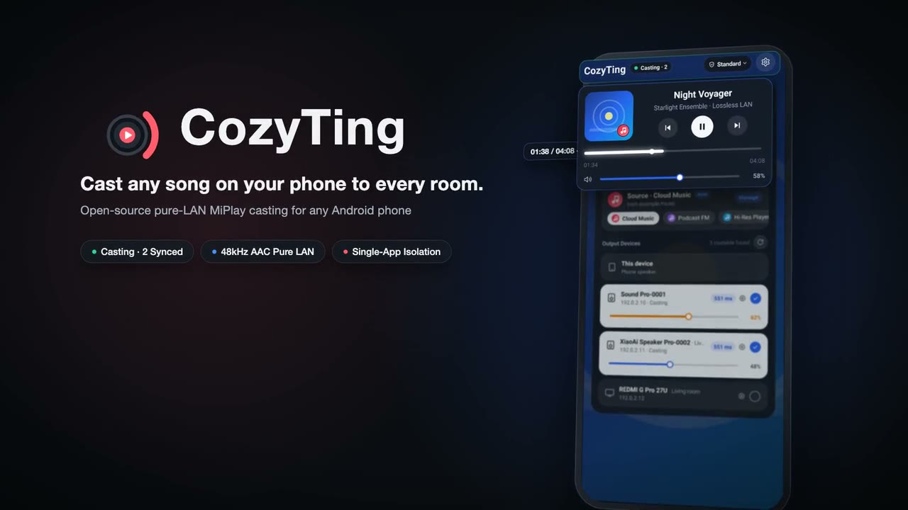
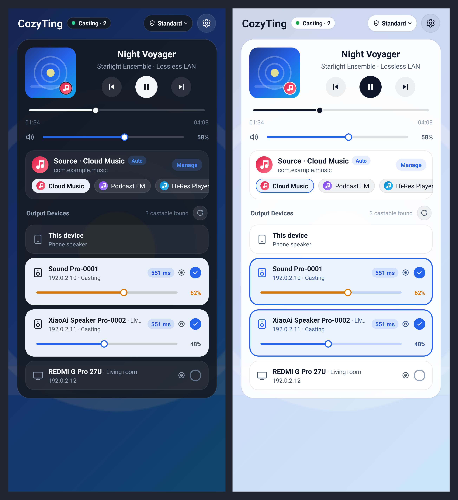
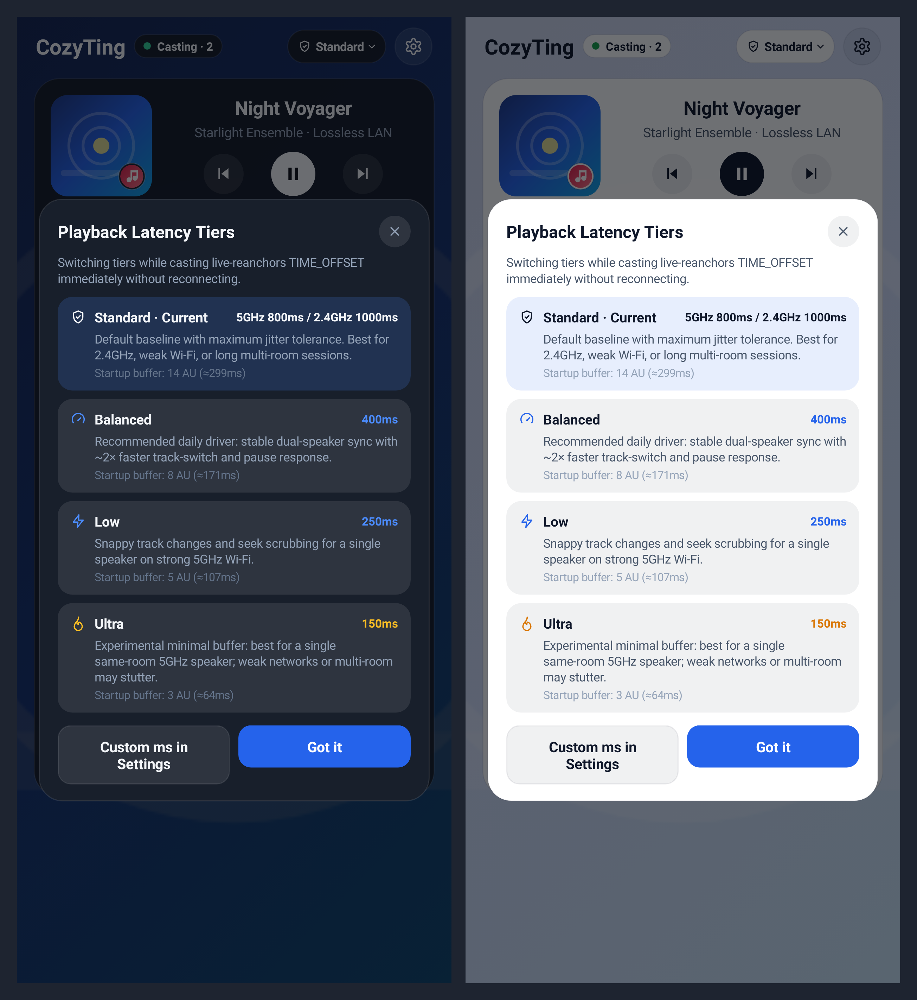
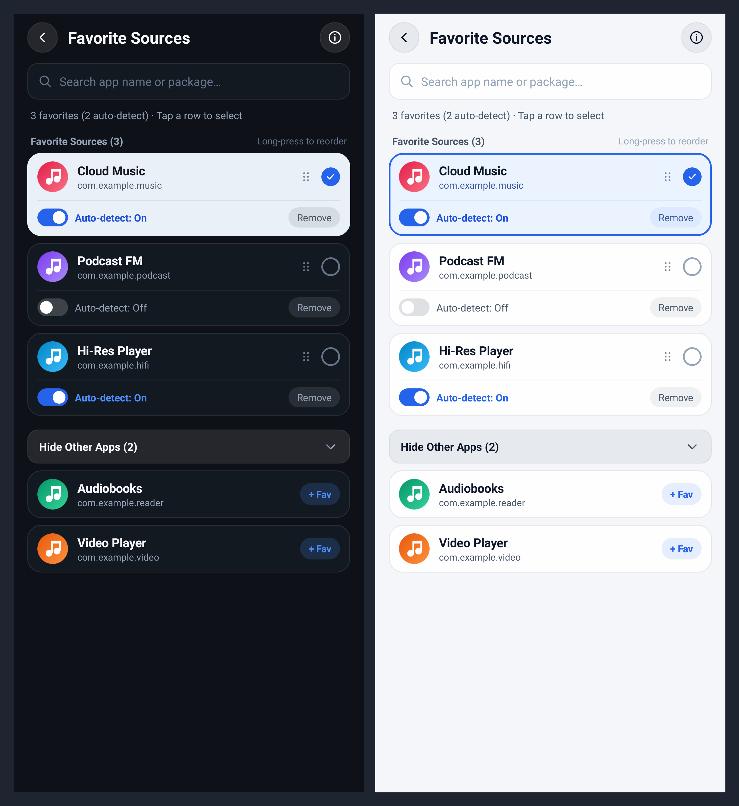
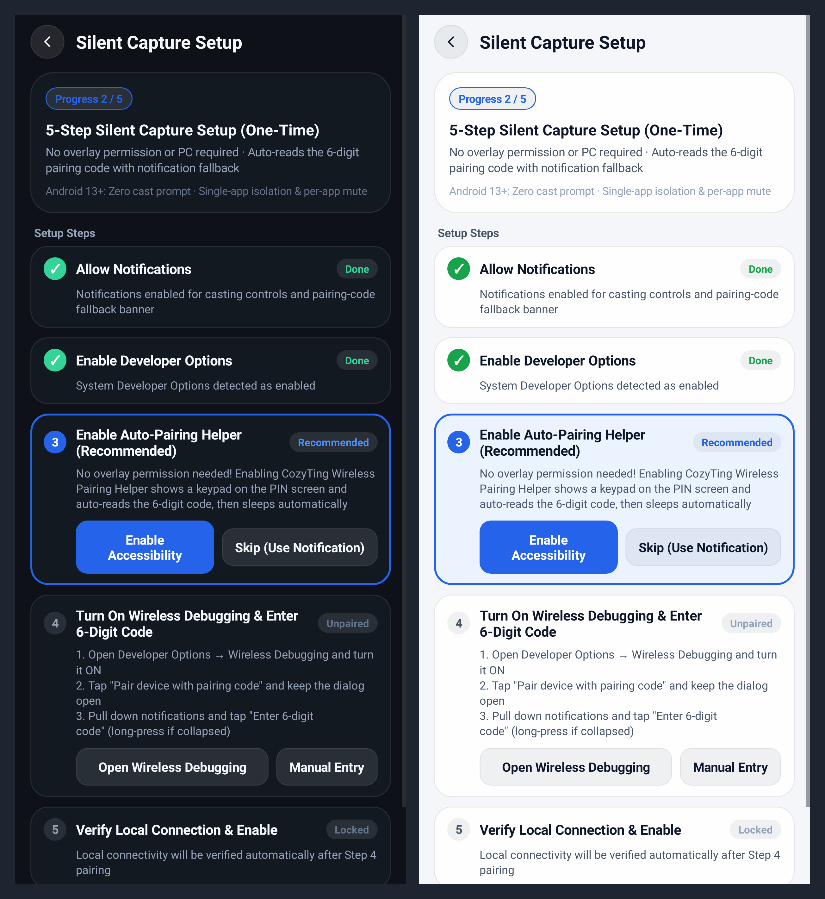
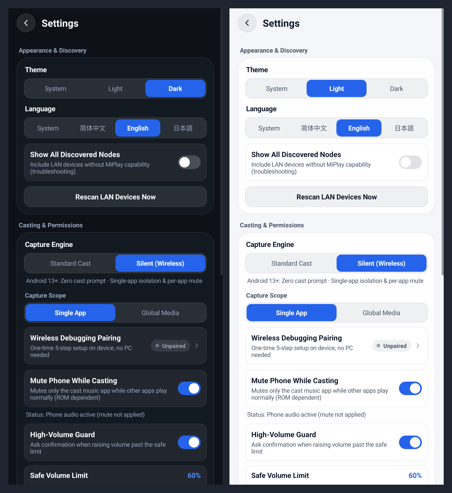
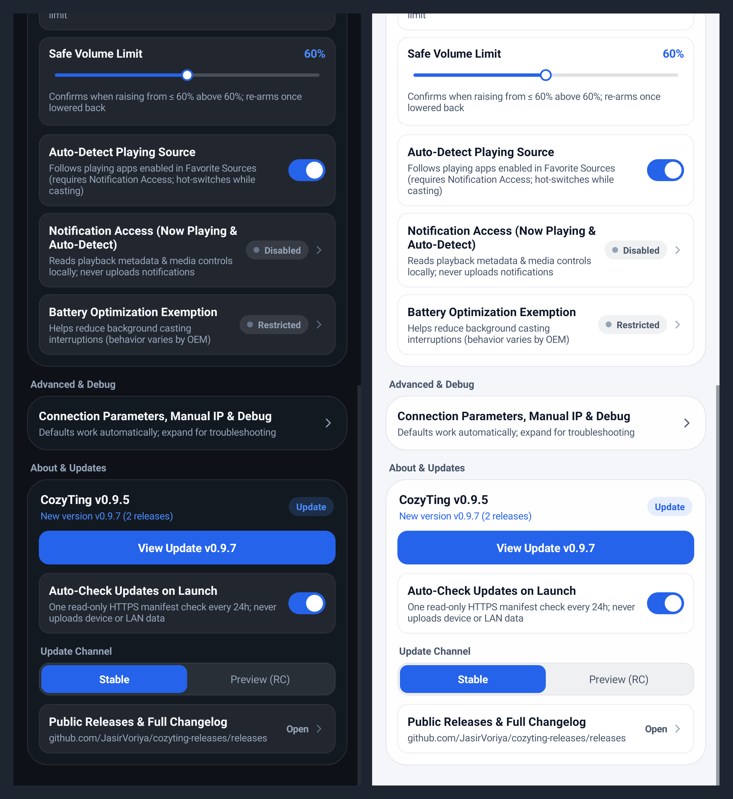
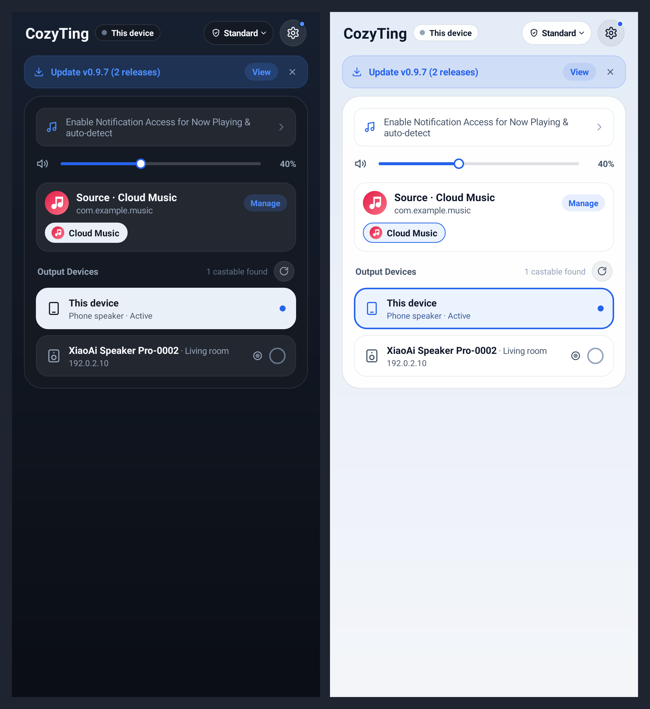
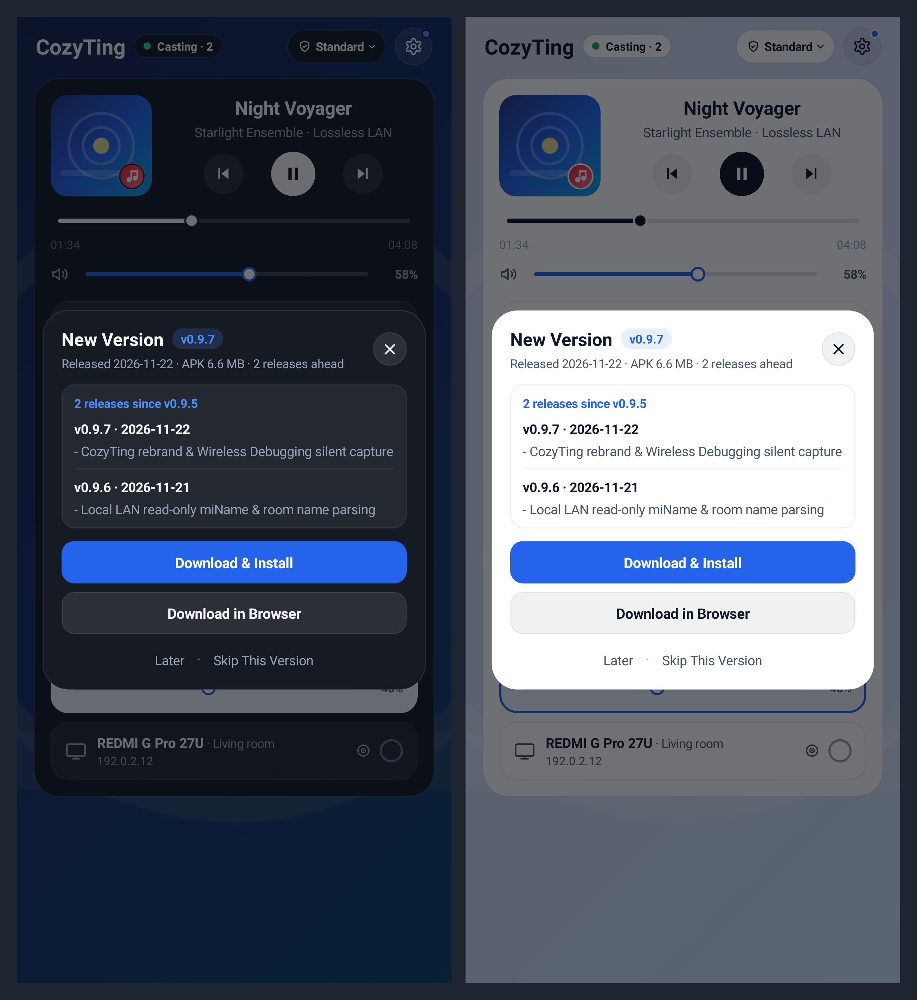
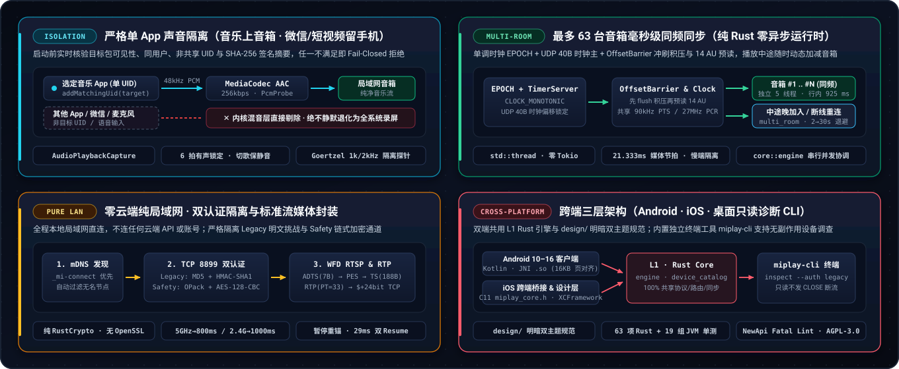

<div align="center">

<picture>
  <source media="(prefers-color-scheme: dark)" srcset="docs/assets/hero-banner-dark.svg">
  <source media="(prefers-color-scheme: light)" srcset="docs/assets/hero-banner-light.svg">
  
</picture>

# CozyTing (窝爱听)

**Open-Source Third-Party MiPlay Audio Casting App: Stream Only Your Chosen Music App to Up to 63 Xiaomi / XiaoAi Speakers Over Pure LAN**

<p>
  <a href="README.md">简体中文</a> · <strong>English</strong> · <a href="README_JA.md">日本語</a> ·
  <a href="https://jasirvoriya.github.io/cozyting-releases/en/">Website</a> ·
  <a href="https://jasirvoriya.github.io/cozyting-releases/en/#video">Video Demo</a> ·
  <a href="https://github.com/JasirVoriya/cozyting-releases/releases">Download APK</a> ·
  <a href="https://jasirvoriya.github.io/cozyting-releases/en/architecture.html">Interactive Architecture</a> ·
  <a href="docs/COMPATIBILITY.md">Compatibility Matrix</a> ·
  <a href="CHANGELOG.md">Changelog</a>
</p>

<p>
  <a href="https://github.com/JasirVoriya/cozyting/actions/workflows/ci.yml"></a>
  <a href="https://github.com/JasirVoriya/cozyting-releases/releases"></a>
  <a href="LICENSE"></a>
  
  
  
  
</p>

</div>

> **What is CozyTing (窝爱听)?**
> **CozyTing** is a free, open-source third-party **MiPlay LAN audio casting app** for Android 10+ (with an iOS SwiftUI client planned on the same Rust core). It lets **any Android phone—Samsung, Pixel, OnePlus, OPPO, vivo, Huawei, or Xiaomi**—cast audio directly from a single chosen music or podcast app (Spotify, Apple Music, NetEase Cloud Music, QQ Music, Pocket Casts, etc.) to one or multiple **Xiaomi / XiaoAi Wi-Fi speakers** (up to 63 synchronized speakers) over your local Wi-Fi network, with **zero cloud servers, zero Xiaomi account login, and no root required**.
>
> 📦 **Download**: Grab the latest Android APK and cross-platform `cozyting-cli` binaries from **[GitHub Releases (cozyting-releases)](https://github.com/JasirVoriya/cozyting-releases/releases)**.
> 📑 **Jump to**: [CozyTing in 1 Minute](#-cozyting-in-1-minute) · [Problems Solved](#1-what-problems-does-cozyting-solve) · [Key Features](#2-key-features) · [App UI Showcase](#3-app-ui-showcase-dark--light-dual-theme) · [3-Step Quick Start](#4-quick-start-for-users-3-steps) · [FAQ](#5-frequently-asked-questions-faq) · [Technical Architecture & Developer Guide](#6-technical-architecture--core-design)

---

## 🎬 CozyTing in 1 Minute

<div align="center">
  <a href="https://jasirvoriya.github.io/cozyting-releases/en/#video" title="Watch CozyTing in 1 Minute on the product website">
    
  </a>
  <p>
    <a href="https://jasirvoriya.github.io/cozyting-releases/en/#video"><strong>▶ Watch on the Product Website</strong></a> ·
    <a href="https://jasirvoriya.github.io/cozyting-releases/assets/video/cozyting-promo-en.mp4">Direct MP4 (1280×720)</a>
  </p>
</div>

> Narration-free walkthrough highlighting **single-app audio isolation**, **up to 63-speaker multi-room sync**, **4-tier live latency switching**, and **Android 13+ root-free seamless capture**. *(UI scenes are rendered demos using placeholder device names and RFC 5737 addresses.)*

---

## 1. What Problems Does CozyTing Solve?

If you own Xiaomi or XiaoAi smart speakers and want to play music from your phone, existing options come with major frustrations:

1. **Brand Lock-In**: Xiaomi's built-in MiPlay ("小米妙播") casting is locked to select Xiaomi / Redmi phones—non-Xiaomi Android users are left out.
2. **Bluetooth Limitations**: Bluetooth usually pairs with only one speaker, drops out when you walk into another room, compresses audio, and cannot keep multi-room speakers in sync.
3. **Embarrassing Audio Leaks**: Bluetooth and full-system screen mirroring broadcast everything—voice messages, short-form videos, game effects, and notification chimes—straight to your living-room speakers.
4. **High Latency & Interrupted Music**: Standard Wi-Fi casting lags on track skips, and opening a video on your phone immediately pauses the music playing on your speakers.

### Comparison: CozyTing vs. Bluetooth vs. Stock MiPlay vs. Screen Mirroring

| Capability | **CozyTing (窝爱听)** | Bluetooth | Stock Xiaomi MiPlay | System Screen Mirroring |
| --- | --- | --- | --- | --- |
| **Phone Brand Support** | ✅ **Any Android 10+ phone** (iOS planned) | ✅ Any phone | ❌ Select Xiaomi / Redmi only | ✅ Any phone |
| **Multi-Room Synchronized Speakers** | ✅ **Up to 63 speakers in ms sync**, live add/remove | ❌ Usually 1 speaker | ✅ Multiple MiPlay speakers | ❌ Single target / high lag |
| **Strict Per-App Audio Isolation** | ✅ **Only your chosen music app**—no chat/alert leaks | ❌ Broadcasts all phone audio | ✅ App-level routing | ❌ Broadcasts all audio & video |
| **Watch Videos Without Pausing Speaker** | ✅ **Dual-zone AudioFocus isolation** (Android 13+ Seamless Mode) | ❌ Videos steal audio focus | ⚠️ ROM-dependent | ❌ Cannot isolate |
| **Range & Audio Quality** | ✅ **Full home Wi-Fi coverage** (48kHz 256kbps AAC) | ❌ Short range, lossy codecs | ✅ Local Wi-Fi | ⚠️ Heavy overhead, recording dot |
| **Live Latency Switching** | ✅ **4 presets (150ms–1000ms) + custom `ms` hot-switch** | ❌ Fixed | ❌ Fixed | ❌ Fixed |
| **Privacy, Account & License** | ✅ **Pure LAN, zero account/cloud, AGPL-3.0 open source** | ✅ Local (proprietary) | ❌ Tied to Xiaomi ecosystem | ⚠️ Vendor-dependent |

---

## 2. Key Features

### 1. Works on Any Android 10+ Phone — 100% Pure LAN, Zero Cloud
- Automatically discovers MiPlay-capable Xiaomi / XiaoAi speakers on your local Wi-Fi network without a Xiaomi account or any cloud relay.
- Filters out non-MiPlay LAN noise by default and displays clean speaker names alongside their configured room names.

### 2. Stream Only Your Selected Music App (Zero Accidental Leaks)
- Captures audio strictly from the single music or podcast app you choose—chat voice messages, incoming notifications, and short-form video feeds stay off your living-room speakers.
- Built-in silence-gap protection prevents brief dual playback on phone and speaker between tracks.

### 3. Seamless Wireless Debugging Mode (Android 13+) — No Root, No PC, No Shizuku
- **Standard Mode** works out of the box on Android 10+ with zero setup.
- On **Android 13+**, CozyTing's built-in **4-step wireless debugging pairing wizard** connects locally via a one-time 6-digit pairing code (no root, no computer, no external Shizuku app required) to unlock:
  - **No recurring projection popups** and no persistent system "casting screen" indicator;
  - **True per-app local mute**: mutes only the music app being cast while other apps continue playing normally through your phone's speaker;
  - **Dual-zone AudioFocus isolation**: scroll TikTok/YouTube or listen to voice messages on your phone without pausing the music playing on your speakers.

### 4. Multi-Room Millisecond Sync for Up to 63 Speakers
- Check multiple speakers at once for synchronized whole-home playback, each with its own **independent volume slider**, room badge, and live inline latency readout (`ms`).
- Add or remove speakers on the fly while music keeps playing uninterrupted.

### 5. 4-Tier Live Latency Switching Without Reconnecting
- Tap the top-bar latency pill to switch buffer targets mid-stream—no disconnect or rebuffering required (plus custom `ms` in Settings):
  - **Standard (5GHz 800ms / 2.4GHz 1000ms)**: Maximum jitter resilience for multi-room and through-wall Wi-Fi listening;
  - **Balanced (400ms)**: Smooth daily multi-speaker default with ~2× faster track-skip response;
  - **Low Latency (250ms)**: Snappy skip & scrub responsiveness for strong 5GHz single-speaker rooms;
  - **Ultra-Low (150ms)**: Experimental minimal-buffer mode for same-room 5GHz single-speaker setups.

### 6. Favorite Audio Sources, Auto-Detect & Modern Dual-Theme UI
- Curate and drag-reorder your favorite music/podcast apps with per-app **Auto-Detect** toggles so playback switches smoothly when you open your favorite player.
- Album-art ambient backdrop, Dark / Light / Follow-System themes, quick launch back into the active music app, and transparent SHA-256 + signature-verified in-app updates (can be turned off with one tap for 100% zero outbound traffic).

---

## 3. App UI Showcase (Dark / Light Dual Theme)

> All screenshots below are rendered directly from the real Android View hierarchy via JVM native Skia with anonymized demo tracks and RFC 5737 mock LAN addresses (`192.0.2.x`).

### 1. Main Screen · Synchronized Multi-Speaker Casting



### 2. 4-Tier Live Latency Switching (Hot-Switch Without Reconnecting)



### 3. Favorite Audio Sources (Per-App Auto-Detect & Drag Reorder)



### 4. Built-In Wireless Debugging 4-Step Seamless Capture Wizard



### 5. Settings · Theme, Capture Engine, Single-App Mute & Permissions



### 6. Settings · Advanced Connection Tuning & About / Updates Card



### 7. Non-Intrusive Update Banner & Badge (Idle State Only)



### 8. Cross-Version Changelog & SHA-256 Verified In-App Update Dialog



---

## 4. Quick Start for Users (3 Steps)

1. **Install the Android APK**
   - Requires **Android 10 (API 29) or higher** (`arm64-v8a`).
   - Download the latest `cozyting-*-arm64-v8a.apk` from **[GitHub Releases (cozyting-releases)](https://github.com/JasirVoriya/cozyting-releases/releases)**.
2. **Connect to the Same Home Wi-Fi**
   - Make sure your phone and Xiaomi / XiaoAi speakers are on the same local Wi-Fi network. CozyTing discovers compatible speakers automatically.
3. **Pick Your Music App & Speakers**
   - Choose your music app (or start playing and let Auto-Detect pick it up), check one or more speakers, and enjoy synchronized playback.
   - **Standard vs. Seamless Mode**: Standard Mode works out of the box on Android 10+. On Android 13+, open *Settings → Capture Engine → Seamless Mode (Wireless Debugging)* and follow the 4-step on-device wizard to eliminate capture popups and enable true per-app mute + dual-zone AudioFocus isolation.

---

## 5. Frequently Asked Questions (FAQ)

### Can non-Xiaomi phones (Samsung, Pixel, OnePlus, OPPO, vivo, Huawei) cast to Xiaomi / XiaoAi speakers with CozyTing?
**Yes.** Any Android 10+ phone on the same Wi-Fi LAN can cast directly to MiPlay-capable Xiaomi / XiaoAi speakers without a Xiaomi account or root. Check tested devices and community reports in the [Compatibility Matrix](docs/COMPATIBILITY.md).

### How is CozyTing different from Bluetooth or AirPlay?
Unlike Bluetooth (single speaker, short range, lossy audio, leaks all phone sounds), CozyTing streams **48kHz 256kbps AAC** over your home Wi-Fi to **up to 63 speakers in millisecond sync**, capturing **only the single music app you select**. Think of it as an open-source, pure-LAN AirPlay-style multi-room experience for MiPlay speakers on Android.

### Will watching videos or playing voice messages leak to the speakers or pause the music?
**No audio leaks.** CozyTing strictly isolates your chosen music app. When using **Seamless Mode on Android 13+**, CozyTing also enables **dual-zone AudioFocus isolation** and **true per-app local mute**, so watching videos or playing chat voice notes on your phone will neither leak to the speakers nor pause your speaker playback.

### Does Seamless Mode require root, a PC, or Shizuku?
**No.** CozyTing embeds a lightweight local wireless ADB client. You only pair once on-device using Android's 6-digit Wireless Debugging pairing code—no root, no computer, and no third-party privilege apps required. Standard Mode remains available on all Android 10+ devices with zero setup.

### Does CozyTing upload audio or require a Xiaomi account?
**Never.** Discovery and audio streaming happen 100% inside your local LAN with zero cloud APIs, zero accounts, and zero telemetry. The only optional internet request is a read-only daily check against the public `update.json` release feed (verified via HTTPS + SHA-256 + APK signature), which you can disable in Settings for 100% zero outbound traffic.

### Is iOS / iPhone supported?
**The shared Rust core (`cozyting_core.h` C ABI + `XCFramework` build pipeline) and cross-platform UI design spec are ready; the native SwiftUI + ReplayKit iOS client is planned.** See [docs/IOS_CLIENT_DESIGN.md](docs/IOS_CLIENT_DESIGN.md) for the roadmap.

---
---

> 👇 **Developer & Engineering Deep-Dive**: Architecture, protocol stack, real-time threading model, CLI diagnostics, and build/test commands.

## 6. Technical Architecture & Core Design

### 1. Engineering Foundation



- **Strict Per-App Isolation (Fail-Closed)**: Uses Android `AudioPlaybackCapture` with single-UID allowlisting plus real-time same-user, non-shared-UID, and SHA-256 package signature verification—never silently falling back to full-system capture or microphone input. A 6-beat `PcmProbe` energy lock prevents dual-output glitches during track transitions.
- **Rootless Wireless Debugging `AudioPolicy` Engine (Android 13+)**: Launches an internal `uid=2000` helper via built-in mDNS + SPAKE2/TLS 1.3 wireless ADB over an ephemeral `127.0.0.1` loopback channel authenticated with a one-time 256-bit token, combining single-app `AudioMix` capture with `AudioPolicyFocusListener` dual-zone AudioFocus isolation.
- **63-Speaker Deterministic Rust Sync Engine**: Pure-Rust L1 core (`miplay-core`) built on `std::thread` and bounded `sync_channel` (**zero async runtime**), with monotonic `EPOCH`, UDP 40B `TimerServer` clock master, `OffsetBarrier` 14-AU preroll alignment, runtime `TIME_OFFSET` hot rebasing, and per-sink slow-consumer eviction.
- **Isolated Legacy & Safety Auth Channels**: Strictly separates Legacy (`MD5 + HMAC-SHA1`) and Safety (`OPack + mutual HMAC + chained AES-128-CBC`) TCP `8899` control sessions.
- **Cross-Platform L1 Core + Read-Only CLI**: Shared L1 Rust core (`engine` / `device_catalog` / `update`) across Android (Kotlin + 16KB-aligned JNI `.so`), iOS (`cozyting_core.h` C ABI + `.xcframework` script), and `cozyting-cli inspect` (read-only diagnostics exiting via `TCP shutdown` without sending `CLOSE`).

### 2. Visual Architecture Overview

> 🧭 **Explore Deeper**:
> - **Interactive Graph**: Open the **[Interactive Architecture Explorer](https://jasirvoriya.github.io/cozyting-releases/en/architecture.html)** (local file: [`docs/en/architecture.html`](docs/en/architecture.html)) to click any module and trace all **↑ upstream producers** and **↓ downstream consumers**.
> - **Full Source Dictionary**: Read **[`docs/ARCHITECTURE.md`](docs/ARCHITECTURE.md)** for complete file-by-file responsibility tables (41 Android files, 24 Rust modules, 19 JVM test suites, and 6-stage lifecycle invariants).

#### (1) Cross-Platform 3-Layer Architecture (L3 UI · L2 System · FFI · L1 Rust Core)


#### (2) Four Orthogonal Data Flows (Media · Control · Clock Sync · Telemetry)


#### (3) Single-Process Real-Time Threading & 6 LAN Channels


### 3. Repository Structure

```text
cozyting/
├── core/               # [L1 Shared Core] Pure Rust protocol, multi-room sync engine, coordinator (engine), catalog & updater
│   ├── include/        #   [FFI] iOS C11 header (cozyting_core.h) & module.modulemap
│   └── src/            #   24 core modules (including Android JNI ffi.rs & iOS C ABI ffi_c.rs)
├── design/             # [L3 Shared Design] Light/dark tokens.json, 20 vector icons (24x24) & UI_SPEC.md
├── android/            # [L2+L3 Android] Native Kotlin client (:app standard/acceptance) & 3-UID isolation testtones
├── cli/                # [Tooling] Standalone cozyting-cli (discover / read-only inspect / cast & fault-injection debug)
├── scripts/            # [Build Pipeline] Android debug/release, iOS XCFramework & 16KB page-alignment verification
└── docs/               # [Docs & Site] Product website (index.html), architecture explorer (architecture.html), docs & llms.txt
```

---

## 7. Developer Quick Start: CLI · Build · Test

```sh
# 1. Discover LAN speakers or run read-only inspection (exits via TCP shutdown without sending CLOSE)
cargo run --release -p cozyting-cli -- discover
cargo run --release -p cozyting-cli -- inspect <SPEAKER_IP> --auth legacy

# 2. Build Android Debug / Release APK (16KB ELF page-aligned) & iOS XCFramework
./scripts/build-debug.sh
./scripts/build-release.sh
./scripts/build-ios-xcframework.sh

# 3. Run Rust unit tests, C11 header check, and Android JVM unit tests + NewApi Fatal Lint
cargo test --workspace
clang -std=c11 -Wall -Wextra -Werror -fsyntax-only core/include/cozyting_core.h
cd android && ./gradlew --no-daemon test lintStandardDebug
```

---

## 8. Honest Scope, Links & License

- **Known Boundaries**: See [docs/LIMITATIONS.md](docs/LIMITATIONS.md) and [docs/COMPATIBILITY.md](docs/COMPATIBILITY.md). Third-party apps opting out via `allowAudioPlaybackCapture="false"` cannot be bypassed; under standard unprivileged Android permissions, muting a single app without affecting `STREAM_MUSIC` is not supported by public APIs (Seamless Mode on Android 13+ requires real-device ROM verification); OEM background freezing and speaker firmware quirks (e.g., [`docs/LX06_V8_POSTMORTEM.md`](docs/LX06_V8_POSTMORTEM.md)) vary by device.
- **Resources**: [Product Website](https://jasirvoriya.github.io/cozyting-releases/en/) · [Interactive Architecture Explorer](https://jasirvoriya.github.io/cozyting-releases/en/architecture.html) · [LLM Summary (`llms.txt`)](docs/llms.txt) · [Security Policy](SECURITY.md) · [Contributing Guide](CONTRIBUTING.md)
- **License**: Released under **[GNU Affero General Public License v3.0 (AGPL-3.0-only)](LICENSE)**.
- **Non-Affiliation Disclaimer**: Independent third-party open-source implementation for LAN interoperability research. Not affiliated with, authorized by, or endorsed by Xiaomi Corporation.
