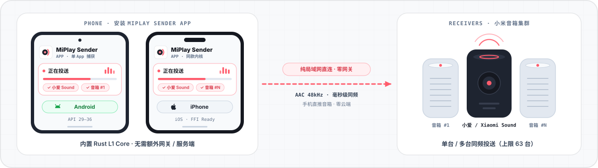

<div align="center">

<picture>
  <source media="(prefers-color-scheme: dark)" srcset="docs/assets/hero-banner-dark.svg">
  <source media="(prefers-color-scheme: light)" srcset="docs/assets/hero-banner-light.svg">
  
</picture>

# MiaoCast (妙投)

**Cross-Platform Pure-LAN Audio Casting via the MiPlay Protocol (Android & iOS) · Zero Cloud · Synchronized Multi-Speaker Engine**

<p>
  <a href="README.md">简体中文</a> · <strong>English</strong> ·
  <a href="https://jasirvoriya.github.io/miaocast-releases/">Interactive Architecture</a> ·
  <a href="docs/ARCHITECTURE.md">Deep-Dive Architecture Doc</a> ·
  <a href="docs/COMPATIBILITY.md">Device Compatibility</a> ·
  <a href="CHANGELOG.md">Changelog</a> ·
  <a href="CONTRIBUTING.md">Contributing</a>
</p>

<p>
  <a href="https://github.com/JasirVoriya/miaocast/actions/workflows/ci.yml"></a>
  <a href="https://github.com/JasirVoriya/miaocast-releases/releases"></a>
  <a href="LICENSE"></a>
  
  
  
  
</p>

</div>

---

## Core Capabilities & Technical Foundation

System-wide screen/audio mirroring broadcasts everything—including chat voice messages, short videos, and notification chimes—straight to your living-room speakers. **MiaoCast (妙投)** solves this with the **MiPlay LAN protocol** and a pure-Rust cross-platform engine (`miplay-core`) that captures **only your selected music app** and synchronizes up to **63 Xiaomi/XiaoAi speakers** in real time:


- **🎯 Strict Per-App Audio Isolation (Fail-Closed)**: Uses Android `AudioPlaybackCapture` with single-UID allowlisting and real-time SHA-256 package signature verification—never silently falling back to full-system capture or microphone input. Includes a 6-beat `PcmProbe` energy lock so track transitions never trigger brief dual-output on phone and speaker.
- **🔊 63-Speaker Millisecond Sync**: Deterministic pure-Rust engine (`std::thread` + bounded `sync_channel`, **zero async runtime**) with monotonic `EPOCH`, UDP 40B `TimerServer` clock master, and `OffsetBarrier` 14-AU preroll alignment.
- **🔐 100% Pure LAN & Dual Auth Isolation**: Zero cloud APIs, zero account logins. Strictly isolates Legacy (`MD5 + HMAC-SHA1`) and Safety (`OPack + mutual HMAC + chained AES-128-CBC`) control channels.
- **🧩 Cross-Platform L1 Core + Read-Only CLI**: Shared L1 Rust core (`engine` / `device_catalog`) and `design/` spec across Android (Kotlin + 16KB-aligned JNI `.so`), iOS (`miplay_core.h` C ABI + `.xcframework` script ready, SwiftUI planned), and `miplay-cli inspect` (read-only diagnostics via TCP shutdown without sending `CLOSE`).

---

## Visual Architecture Overview

> 🧭 **Explore Deeper**:
> - **Interactive Graph**: Open the **[Interactive Architecture Explorer](https://jasirvoriya.github.io/miaocast-releases/)** (local file: [`docs/architecture.html`](docs/architecture.html)) to click any module and trace all **↑ upstream producers** and **↓ downstream consumers**.
> - **Full Source Dictionary**: Read **[`docs/ARCHITECTURE.md`](docs/ARCHITECTURE.md)** for the complete file-by-file responsibility tables (41 Android files, 24 Rust modules, 19 JVM test suites, and 6-stage lifecycle invariants).

### 1. Cross-Platform 3-Layer Architecture (L3 UI · L2 System · FFI · L1 Rust Core)



### 2. Four Orthogonal Data Flows (Media · Control · Clock Sync · Telemetry)



### 3. Single-Process Real-Time Threading & 6 LAN Channels



---

## Repository Structure

```text
miaocast/
├── core/               # [L1 Shared Core] Pure Rust protocol, multi-room sync engine, coordinator (engine) & catalog
│   ├── include/        #   [FFI] iOS C11 header (miplay_core.h) & module.modulemap
│   └── src/            #   24 core modules (including Android JNI ffi.rs & iOS C ABI ffi_c.rs)
├── design/             # [L3 Shared Design] Light/dark tokens.json, 20 vector icons (24x24) & UI_SPEC.md
├── android/            # [L2+L3 Android] Native Kotlin client (:app standard/acceptance) & 3-UID isolation testtones
├── cli/                # [Tooling] Standalone miplay-cli (discover / read-only inspect / cast & fault-injection debug)
├── scripts/            # [Build Pipeline] Android debug/release, iOS XCFramework & 16KB page-alignment verification
└── docs/               # [Docs & Visuals] Interactive explorer (architecture.html), ARCHITECTURE.md & COMPATIBILITY.md
```

---

## Quick Start: CLI · Build · Test

```sh
# 1. Discover LAN speakers or run read-only inspection (exits via TCP shutdown without sending CLOSE)
cargo run --release -p miplay-cli -- discover
cargo run --release -p miplay-cli -- inspect <SPEAKER_IP> --auth legacy

# 2. Build Android Debug / Release APK (16KB ELF page-aligned) & iOS XCFramework
./scripts/build-debug.sh
./scripts/build-release.sh
./scripts/build-ios-xcframework.sh

# 3. Run Rust unit tests (63), C11 header check, and Android JVM unit tests (19 suites) + NewApi Fatal Lint
cargo test --workspace
clang -std=c11 -Wall -Wextra -Werror -fsyntax-only core/include/miplay_core.h
cd android && ./gradlew --no-daemon test lintStandardDebug
```

Prebuilt APKs and cross-platform `miplay-cli` binaries are published on **[GitHub Releases (miaocast-releases)](https://github.com/JasirVoriya/miaocast-releases/releases)**.

---

## Honest Scope & License

- **Known Boundaries**: See [docs/LIMITATIONS.md](docs/LIMITATIONS.md) and [docs/COMPATIBILITY.md](docs/COMPATIBILITY.md). Third-party apps opting out via `allowAudioPlaybackCapture="false"` cannot be bypassed; unprivileged Android APIs cannot mute a single app without affecting `STREAM_MUSIC`; OEM background freezing and specific speaker firmware quirks (e.g., [`docs/LX06_V8_POSTMORTEM.md`](docs/LX06_V8_POSTMORTEM.md)) require real-device verification.
- **License**: Released under **[GNU Affero General Public License v3.0 (AGPL-3.0-only)](LICENSE)**.
- **Non-Affiliation Disclaimer**: Independent third-party open-source implementation for LAN interoperability research. Not affiliated with, authorized by, or endorsed by Xiaomi Corporation.
