<div align="center">

<picture>
  <source media="(prefers-color-scheme: dark)" srcset="docs/assets/hero-banner-dark.svg">
  <source media="(prefers-color-scheme: light)" srcset="docs/assets/hero-banner-light.svg">
  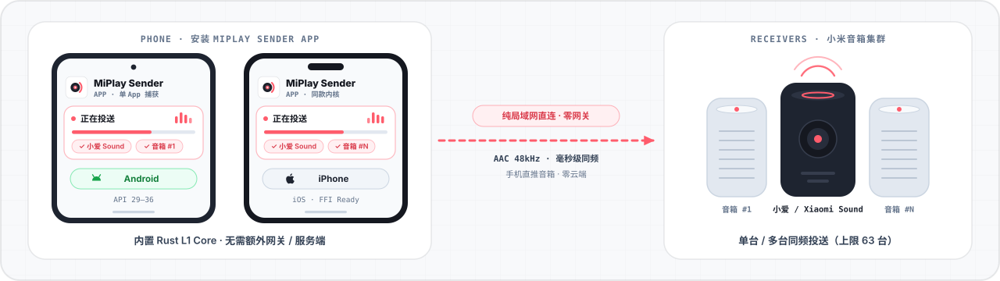
</picture>

# MiaoCast（妙投）

**端末メーカー不問・完全 LAN 動作のオープンソース MiPlay 音声送信クライアント：選んだ 1 つの音楽アプリだけを最大 63 台の Xiaomi / XiaoAi スピーカーへミリ秒同期送信**

<p>
  <a href="README.md">简体中文</a> · <a href="README_EN.md">English</a> · <strong>日本語</strong> ·
  <a href="https://jasirvoriya.github.io/miaocast-releases/ja/">製品サイト</a> ·
  <a href="https://jasirvoriya.github.io/miaocast-releases/ja/#video">デモ動画</a> ·
  <a href="https://github.com/JasirVoriya/miaocast-releases/releases">APK ダウンロード</a> ·
  <a href="https://jasirvoriya.github.io/miaocast-releases/ja/architecture.html">アーキテクチャ図</a> ·
  <a href="docs/COMPATIBILITY.md">互換マトリクス</a> ·
  <a href="CHANGELOG.md">変更履歴</a>
</p>

<p>
  <a href="https://github.com/JasirVoriya/miaocast/actions/workflows/ci.yml"></a>
  <a href="https://github.com/JasirVoriya/miaocast-releases/releases"></a>
  <a href="LICENSE"></a>
  
  
  
  
</p>

</div>

> **MiaoCast（妙投）とは？**
> **MiaoCast** は無料・オープンソースのサードパーティ製 **MiPlay 完全 LAN 音声送信アプリ**（Android 10+ 対応、共通 Rust コア上の iOS SwiftUI 版を計画中）です。**Pixel・Galaxy・Xperia・OnePlus・OPPO・vivo・Huawei・Xiaomi など端末メーカーを問わず**、Root 不要・Xiaomi アカウント不要・クラウド不要で、選んだ 1 つの音楽・ポッドキャストアプリ（Spotify、Apple Music、YouTube Music、NetEase Cloud Music など）の音声だけを自宅 Wi-Fi 経由で最大 63 台の **Xiaomi / XiaoAi スピーカー** へミリ秒同期再生します。日本語・英語・簡体字中国語の 3 言語にネイティブ対応しています。
>
> 📦 **ダウンロード**：最新の署名済み Android APK およびクロスプラットフォーム診断 CLI `miaocast-cli` は **[GitHub Releases（miaocast-releases）](https://github.com/JasirVoriya/miaocast-releases/releases)** から入手できます。
> 📑 **目次**：[1 分でわかる MiaoCast](#-1-分でわかる-miaocast) · [解決する課題](#1-解決する-4-つの課題) · [主な機能](#2-主な機能) · [画面プレビュー](#3-画面プレビューダークライト両対応) · [3 ステップ導入](#4-3-ステップ導入ガイド) · [よくある質問](#5-よくある質問faq) · [技術アーキテクチャ](#6-技術アーキテクチャとコア設計)

---

## 🎬 1 分でわかる MiaoCast

<div align="center">
  <a href="https://jasirvoriya.github.io/miaocast-releases/ja/#video" title="製品サイトでデモ動画を再生：1 分でわかる MiaoCast">
    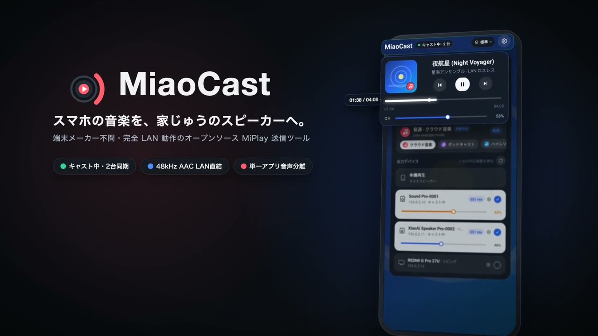
  </a>
  <p>
    <a href="https://jasirvoriya.github.io/miaocast-releases/ja/#video"><strong>▶ 製品サイトで動画を視聴</strong></a> ·
    <a href="https://jasirvoriya.github.io/miaocast-releases/assets/video/miaocast-promo-ja.mp4">MP4 を直接再生 / ダウンロード（1280×720）</a>
  </p>
</div>

> ナレーションなしのビジュアルデモ：**単一アプリ音声分離**、**最大 63 台のマルチルーム同期**、**4 段階遅延の即時切替**、**Android 13+ Root 不要サイレント送信** を 62 秒で紹介しています。（※ 画面はデモ描画であり、機器名および RFC 5737 IP アドレスはプレースホルダです。）

---

## 1. 解決する 4 つの課題

自宅の Xiaomi / XiaoAi スピーカーでスマホの音楽を聴こうとすると、次のような課題に直面しがちです：

1. **Xiaomi 以外の端末では純正「MiPlay」が使えない**：Pixel・Galaxy・Xperia・OPPO・vivo・Huawei などの端末には純正入口がなく、Bluetooth 接続に頼るしかありません。
2. **Bluetooth は 1 台限定で不安定**：部屋を移動すると壁越しに途切れ、圧縮音質になるうえ、リビング・寝室・書斎の複数スピーカーを同時に同期再生できません。
3. **通知音やボイスメッセージの意図しない音漏れ**：Bluetooth や画面ミラーリングでは、チャット音声・ショート動画・通知音まで家じゅうのスピーカーへ流れてしまいます。
4. **高遅延と動画視聴による音楽停止**：従来のキャストは曲送り応答が遅く、スマホでショート動画を開くとスピーカーの音楽が即座に止まってしまいます。

### 比較：MiaoCast vs. Bluetooth vs. 純正 MiPlay vs. 画面ミラーリング

| 比較項目 | **MiaoCast（妙投）** | Bluetooth 接続 | 純正 Xiaomi MiPlay | 画面ミラーリング |
| --- | --- | --- | --- | --- |
| **対応スマホメーカー** | ✅ **メーカー不問**（あらゆる Android 10+・iOS 計画中） | ✅ メーカー不問 | ❌ 一部 Xiaomi / Redmi のみ | ✅ メーカー不問 |
| **マルチルーム同期再生** | ✅ **最大 63 台をミリ秒同期**・再生中の追加/解除可 | ❌ 通常 1 台限定・複数台はズレ発生 | ✅ 複数 MiPlay 機器に対応 | ❌ 単体または高遅延 |
| **単一アプリ音声分離** | ✅ **選択した音楽アプリのみ送信**・通知や通話漏れゼロ | ❌ 端末の全音声をそのまま出力 | ✅ メディアソース指定に対応 | ❌ 画面・音声すべてを出力 |
| **動画視聴で音楽が止まらない** | ✅ **デュアルゾーン AudioFocus 分離**（Android 13+ サイレント） | ❌ 動画再生で音楽が即停止 | ⚠️ OS バージョン依存 | ❌ 分離不可 |
| **通信範囲と音質** | ✅ **自宅 Wi-Fi 全域で安定**（48kHz 256kbps AAC） | ❌ 壁越しで途切れやすい | ✅ ローカル Wi-Fi | ⚠️ 高負荷・常時録画インジケータ |
| **再生遅延のリアルタイム切替** | ✅ **4 段階（150ms–1000ms）＋カスタム `ms` を切断なしで切替** | ❌ 調整不可 | ❌ 調整不可 | ❌ 調整不可 |
| **プライバシー・ライセンス** | ✅ **完全 LAN・アカウント不要・AGPL-3.0 オープンソース** | ✅ ローカル（クローズド） | ❌ Xiaomi アカウント・純正 ROM 依存 | ⚠️ ベンダー依存 |

---

## 2. 主な機能

### 1. 端末メーカー不問・完全 LAN 直結（クラウド不要）
- 同じ自宅 Wi-Fi LAN にある MiPlay 対応 Xiaomi / XiaoAi スピーカーを自動検出し、**Xiaomi アカウント不要・外部サーバー経由ゼロ** で直接接続します。
- MiPlay 非対応の機器を既定でフィルタリングし、スピーカーの実名と部屋名をすっきり表示します。

### 2. 選んだ 1 つの音楽アプリだけを送信（音漏れゼロ）
- 厳格な Fail-Closed 単一 UID 分離を採用。全端末録音やマイク収音へフォールバックすることなく、選んだ音楽アプリだけを送信します。
- 6 拍有音ロック機能により、曲間の無音タイミングでのスマホ本体二重再生も防ぎます。

### 3. 内蔵ワイヤレスデバッグ「サイレントモード」（Android 13+・Root / PC / Shizuku 不要）
- **標準キャストモード** は Android 10+ 全機種で設定不要のまま即利用可能。
- **Android 13+** では、アプリ内蔵のガイドに沿って Android の 6 桁ペアリングコードを一度入力するだけで（Root・PC・Shizuku すべて不要）、以下を解放できます：
  - **毎回確認ダイアログなし**：画面キャスト確認ダイアログや常時キャスト表示を省略；
  - **単一アプリのスマホ本体ミュート**：キャスト中の音楽アプリだけを消音し、他アプリは通常通りスマホから出力；
  - **デュアルゾーン AudioFocus 分離**：リビングで音楽を流したままスマホで動画やボイスメッセージを再生しても音楽が止まりません。

### 4. 最大 63 台のマルチルーム同期・途中追加/解除
- 複数スピーカーを同時にチェックしてミリ秒単位で同期再生。各機器に**独立音量スライダー・部屋名・リアルタイム遅延（`ms`）** を表示し、曲の途中でも自由に追加・解除できます。

### 5. 4 段階遅延モードを再生中に即時切替
- 上部バーの遅延ピルから切断なしでリアルタイム切替（設定でカスタム `ms` 指定も可）：
  - **標準（5GHz 800ms / 2.4GHz 1000ms）**：壁越し・弱電波・長時間マルチルーム向けの安定基準；
  - **バランス（400ms）**：普段使いに最適、複数台同期を保ちつつ曲送り応答を約 2 倍高速化；
  - **低遅延（250ms）**：安定した 5GHz 単体スピーカー向け、シーク操作が軽快；
  - **超低遅延（150ms）**：同室 5GHz 単体スピーカー向けの実験的極小バッファ。

### 6. よく使う音源の自動追従・多言語・ダーク/ライト UI
- よく使う音楽/ポッドキャストアプリを登録・並べ替え、アプリ別に「自動検出」をオンにすれば、別アプリで再生を始めるだけでシームレスに追従します。
- アルバム連動背景、ダーク/ライト/システム連動テーマ、アプリ内言語切替（自動・简体中文・English・日本語）、SHA-256＋署名証明書検証付きアップデート（設定で完全オフ可）を備えます。

---

## 3. 画面プレビュー（ダーク・ライト両対応）

> 以下のスクリーンショットはすべて Android 実機ビュー階層から Skia で直接レンダリングした日本語版 UI です（プレースホルダ曲名および RFC 5737 アドレス `192.0.2.x` を使用）。

### 1. メイン画面・複数スピーカー同期キャスト

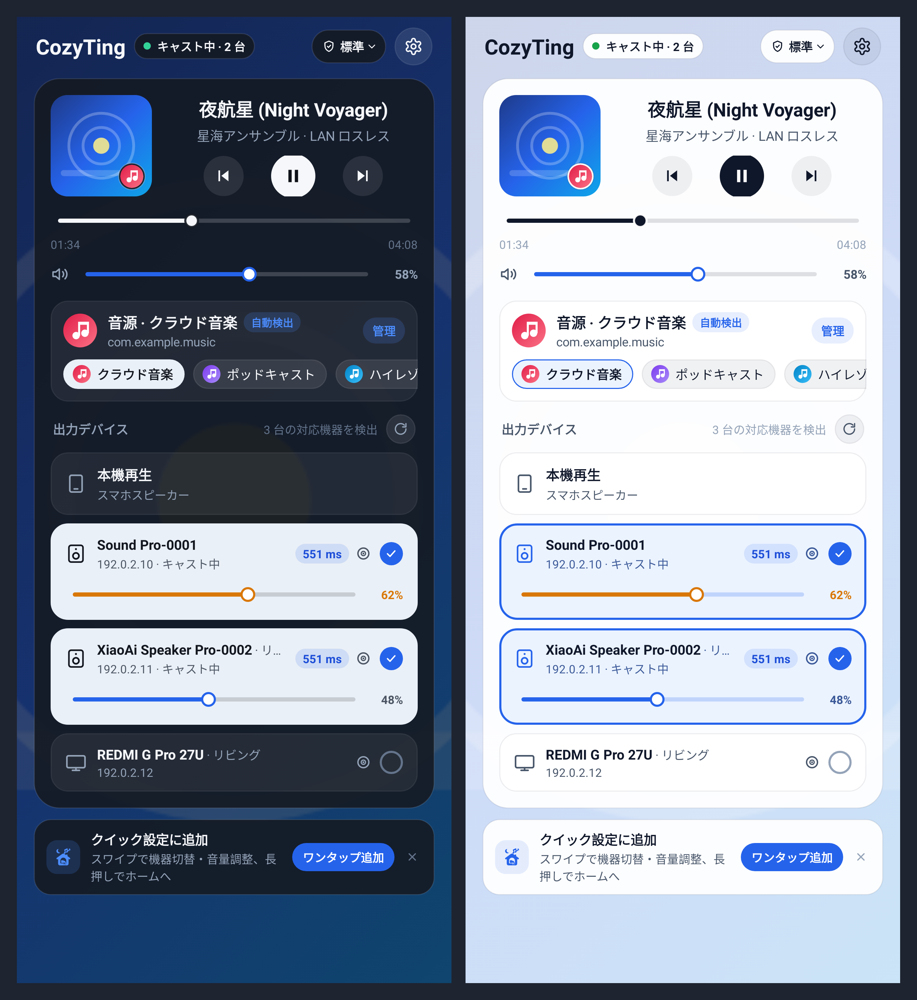

### 2. 4 段階遅延モードのリアルタイム切替

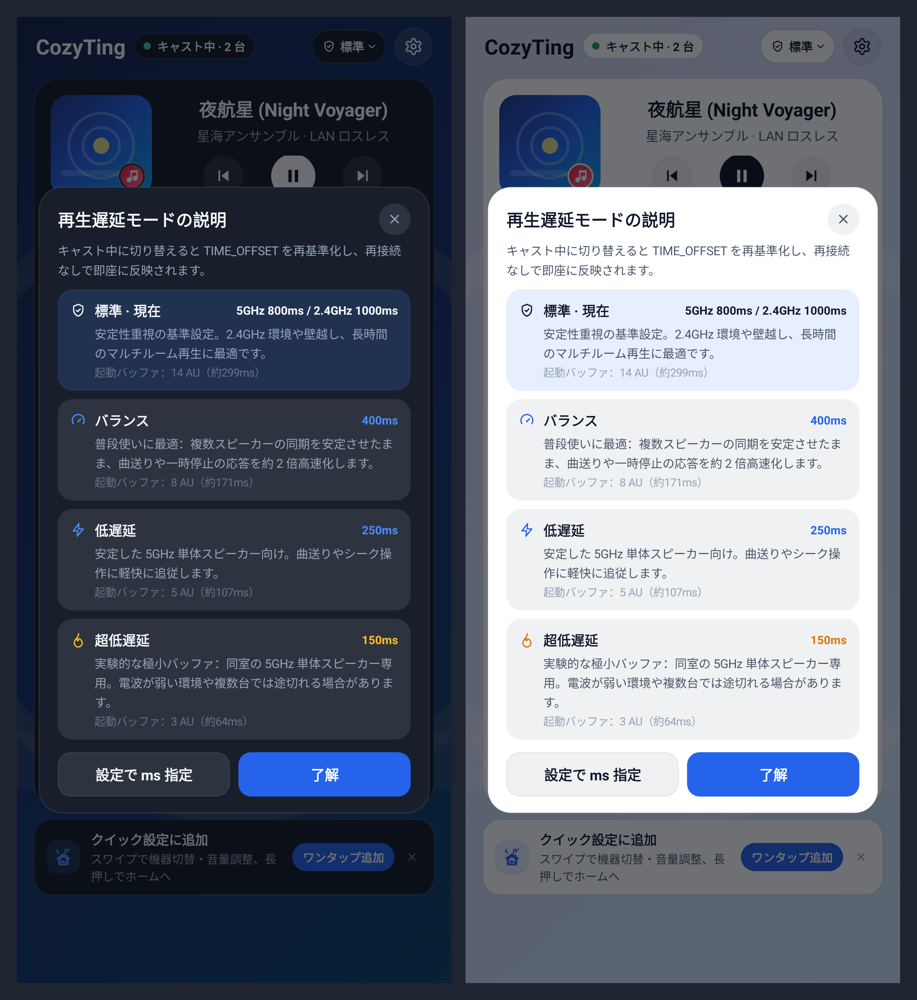

### 3. よく使う音源管理（自動検出・ドラッグ並べ替え）

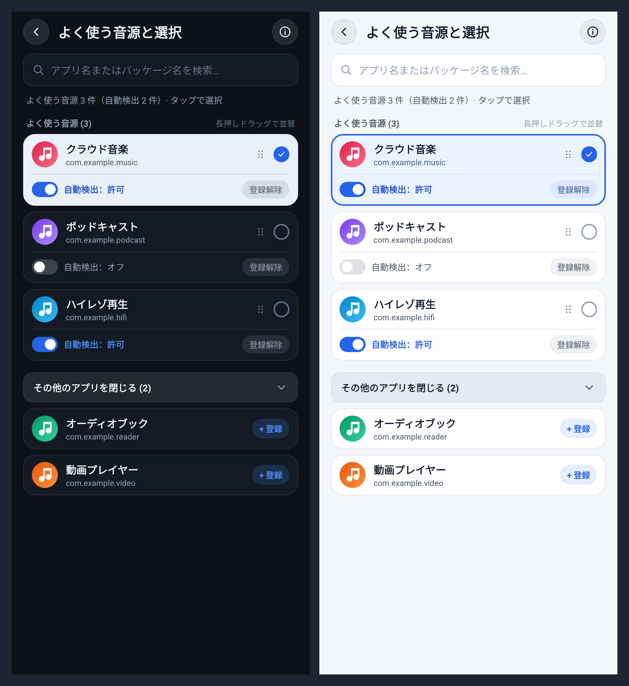

### 4. 内蔵ワイヤレスデバッグ・サイレントキャプチャ設定ガイド

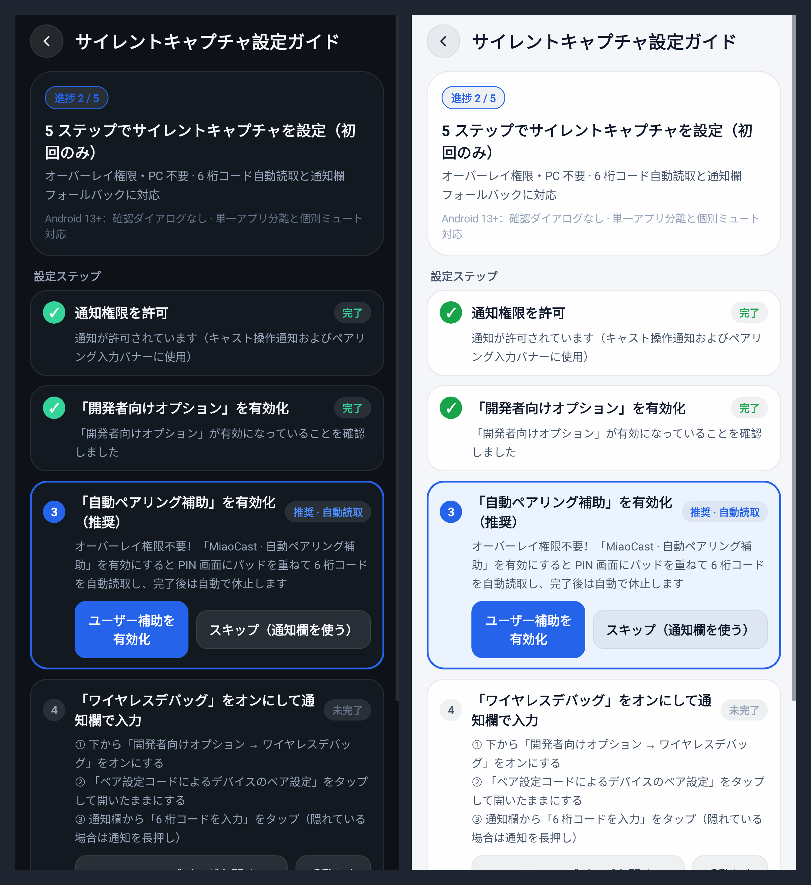

### 5. 設定画面・テーマ・表示言語・キャプチャエンジン・スマホミュート

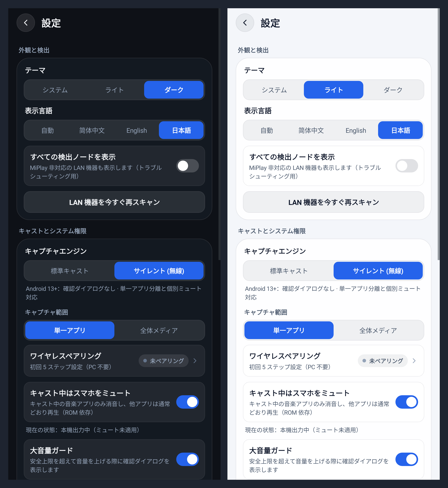

### 6. 設定画面・大音量ガードとアップデート確認

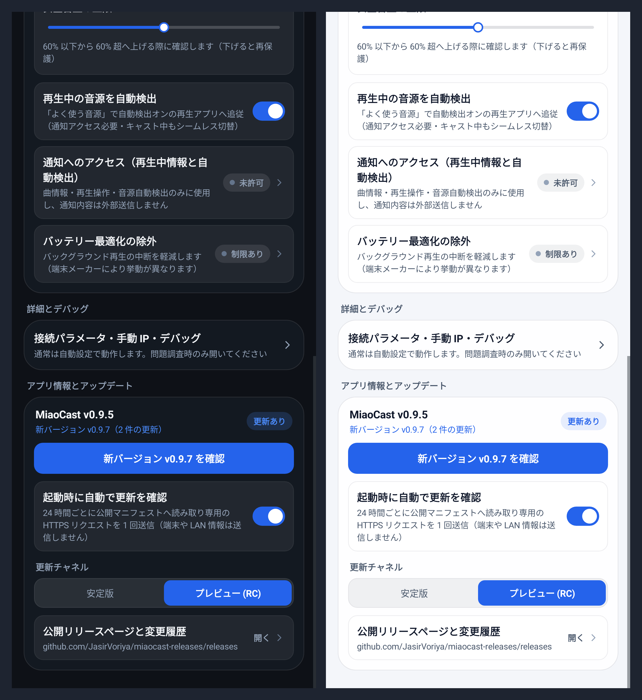

### 7. 控えめなアップデート通知バナー（待機中のみ表示）

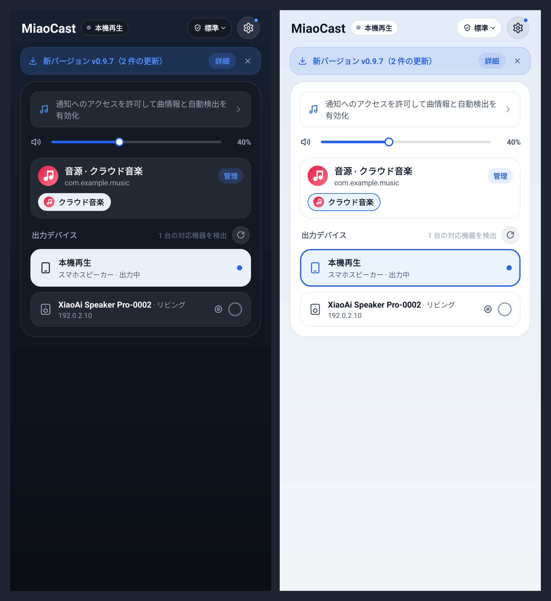

### 8. バージョン横断変更履歴と SHA-256 署名検証アップデートダイアログ

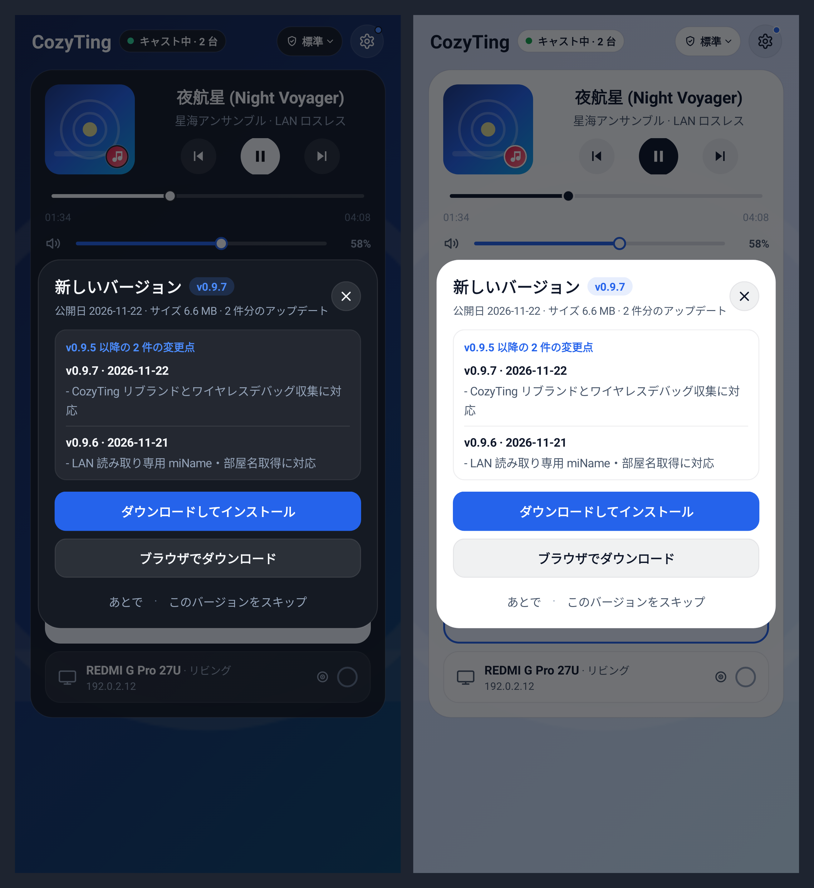

---

## 4. 3 ステップ導入ガイド

1. **Android APK をインストール**
   - **Android 10（API 29）以上**（`arm64-v8a`）に対応しています。
   - **[GitHub Releases（miaocast-releases）](https://github.com/JasirVoriya/miaocast-releases/releases)** から最新の署名済み `miaocast-*-arm64-v8a.apk` をダウンロードしてインストールします。
2. **同じ自宅 Wi-Fi に接続**
   - スマホと Xiaomi / XiaoAi スピーカーを同じローカル Wi-Fi に接続すると、対応スピーカーが自動検出されます。
3. **音楽アプリとスピーカーを選択して再生**
   - 音楽アプリを選び（または自動検出に任せて再生開始）、スピーカーにチェックを入れるだけで同期再生が始まります。
   - Android 13+ では *設定 → キャプチャエンジン → サイレント（無線）* から画面のガイドに沿って初回ペアリングを行うと、確認ダイアログ省略・個別ミュート・デュアルゾーン AudioFocus 分離が使えます。

---

## 5. よくある質問（FAQ）

### Xiaomi 以外のスマホ（Pixel・Galaxy・Xperia・OPPO・vivo・Huawei）でも使えますか？
**はい。** Android 10 以上でスピーカーと同じ Wi-Fi LAN に接続していれば、Xiaomi 端末・Xiaomi アカウント・Root のいずれも不要で直接送信できます。実機テスト結果は [機器互換マトリクス](docs/COMPATIBILITY.md) をご覧ください。

### Bluetooth や AirPlay とどう違いますか？
Bluetooth（単体・近距離・全音声出力）とは異なり、MiaoCast は自宅 Wi-Fi で **48kHz 256kbps AAC** を **最大 63 台へミリ秒同期送信** し、**選んだ音楽アプリだけ** を分離します。Android で使えるオープンソース・完全 LAN のマルチルーム音声送信クライアントです。

### 動画視聴やボイスメッセージ再生で音漏れしたり、スピーカーの音楽が止まったりしますか？
**音漏れしません。** MiaoCast は指定した音楽アプリのみを分離収集します。Android 13+ の **サイレントモード** を有効にすると **デュアルゾーン AudioFocus 分離** と **単一アプリミュート** が働き、スマホで動画やボイスメッセージを再生してもスピーカーの音楽が止まりません。

### サイレントモードに Root・PC・Shizuku は必要ですか？
**不要です。** MiaoCast 内蔵のワイヤレスデバッグクライアントを使い、端末内で Android の 6 桁ペアリングコードを一度入力するだけで完結します。設定不要で始めたい場合は Android 10+ 全機種対応の標準モードをそのまま使えます。

### 音声をクラウドにアップロードしたり、Xiaomi アカウントのログインを求められたりしますか？
**一切ありません。** 機器検出・音声ストリーミングともに 100% 自宅 LAN 内で完結します。任意の 1 日 1 回アップデート確認（公開 `update.json` の読み取り専用 HTTPS 取得・SHA-256 署名検証）も設定からオフにでき、完全ゼロ外部通信で運用できます。

### iOS / iPhone に対応していますか？
**共通 Rust コア（`miaocast_core.h` C ABI＋`XCFramework` ビルド基盤）とクロスプラットフォーム UI 仕様は整備済みで、ネイティブ SwiftUI + ReplayKit 版 iOS クライアントを計画中です。** 詳細は [docs/IOS_CLIENT_DESIGN.md](docs/IOS_CLIENT_DESIGN.md) を参照してください。

---
---

> 👇 **開発者・エンジニア向け詳細**：アーキテクチャ、プロトコルスタック、リアルタイムスレッド設計、CLI 診断、ビルド・テスト手順。

## 6. 技術アーキテクチャとコア設計

### 1. エンジニアリング基盤

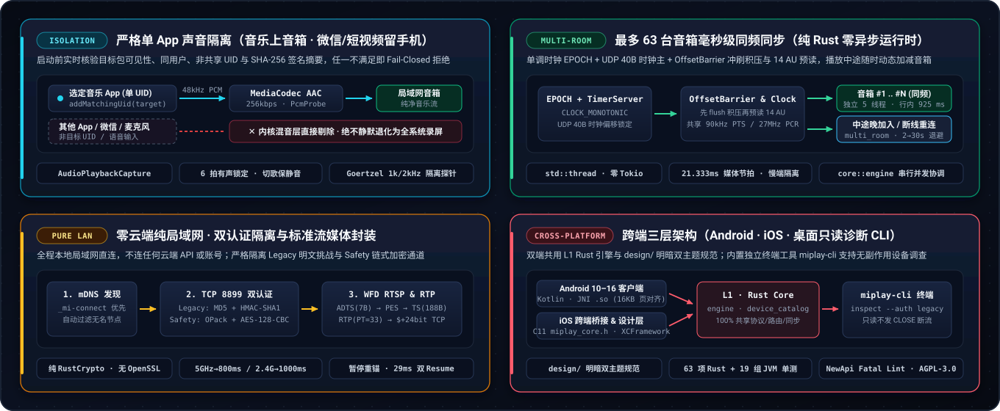

- **厳格な単一アプリ分離（Fail-Closed）**：単一 UID 許可リストによる `AudioPlaybackCapture` に加え、同一ユーザー・非共有 UID・SHA-256 署名ダイジェストをリアルタイム検証し、全端末録音やマイク入力へフォールバックしません。
- **Root 不要ワイヤレスデバッグ `AudioPolicy` エンジン（Android 13+）**：内蔵 mDNS＋SPAKE2/TLS 1.3 無線 ADB でワンタイム 256-bit トークン認証の `127.0.0.1` ループバック経由 `uid=2000` ヘルパーを起動し、単一アプリ `AudioMix` 収集と `AudioPolicyFocusListener` デュアルゾーン分離を統合します。
- **最大 63 台対応の決定論的 Rust 同期エンジン**：`std::thread` と有界 `sync_channel` のみで構成された純 Rust L1 コア（**非同期ランタイム不使用**）。単調クロック `EPOCH`、40B UDP `TimerServer`、`OffsetBarrier` 14 AU プリロール、ランタイム `TIME_OFFSET` 再基準化、遅延受信機の個別切り離しを実装。
- **Legacy / Safety 認証チャネルの厳格分離**：TCP `8899` の Legacy（`MD5 + HMAC-SHA1`）と Safety（`OPack + 双方向 HMAC + 連鎖 AES-128-CBC`）を完全分離。
- **クロスプラットフォーム L1 コア＋読み取り専用 CLI**：Android（Kotlin＋16KB 整列 JNI `.so`）、iOS（`miaocast_core.h` C ABI＋`.xcframework`）、および `CLOSE` 非送信の診断ツール `miaocast-cli inspect` で L1 コアを共有。

### 2. アーキテクチャ図と詳細資料

> 🧭 **さらに詳しく見る**：
> - **インタラクティブ図**：**[インタラクティブ・アーキテクチャブラウザ（日本語）](https://jasirvoriya.github.io/miaocast-releases/ja/architecture.html)**（ローカル：[`docs/ja/architecture.html`](docs/ja/architecture.html)）で任意のモジュールをクリックし **↑ 上流ソース** と **↓ 下流コンシューマ** を追跡できます。
> - **設計マニュアル**：全モジュールの責務一覧・データフロー・6 段階ライフサイクル不変条件は **[`docs/ARCHITECTURE.md`](docs/ARCHITECTURE.md)** を参照してください。




---

## 7. 開発者クイックスタート：CLI・ビルド・テスト

```sh
# 1. LAN スピーカー検出または読み取り専用診断（CLOSE を送らず TCP shutdown で終了）
cargo run --release -p miaocast-cli -- discover
cargo run --release -p miaocast-cli -- inspect <SPEAKER_IP> --auth legacy

# 2. Android Debug / Release APK（16KB ELF ページ整列）および iOS XCFramework ビルド
./scripts/build-debug.sh
./scripts/build-release.sh
./scripts/build-ios-xcframework.sh

# 3. Rust 単体テスト、C11 ヘッダ検証、Android JVM テスト＋NewApi Fatal Lint
cargo test --workspace
clang -std=c11 -Wall -Wextra -Werror -fsyntax-only core/include/miaocast_core.h
cd android && ./gradlew --no-daemon test lintStandardDebug
```

---

## 8. 検証境界・リンク・ライセンス

- **既知の制約**：[docs/LIMITATIONS.md](docs/LIMITATIONS.md) と [docs/COMPATIBILITY.md](docs/COMPATIBILITY.md) を参照してください。`allowAudioPlaybackCapture="false"` を明示したサードパーティアプリはバイパスできません。標準モードの公開 Android API では `STREAM_MUSIC` 全体に影響せず単一アプリのみ消音することは不可（Android 13+ サイレントモードは端末 ROM 依存）。OEM 省電力凍結や機種固有のファームウェア挙動（[`docs/LX06_V8_POSTMORTEM.md`](docs/LX06_V8_POSTMORTEM.md) 等）は機種ごとに異なります。
- **関連リンク**：[製品サイト（日本語）](https://jasirvoriya.github.io/miaocast-releases/ja/) · [アーキテクチャブラウザ（日本語）](https://jasirvoriya.github.io/miaocast-releases/ja/architecture.html) · [LLM 要約 (`llms.txt`)](docs/llms.txt) · [セキュリティポリシー](SECURITY.md) · [コントリビューションガイド](CONTRIBUTING.md)
- **ライセンス**：**[GNU Affero General Public License v3.0 (AGPL-3.0-only)](LICENSE)** で公開されています。
- **非公式プロジェクト表記**：LAN 相互運用性研究のための独立したサードパーティ製オープンソース実装であり、Xiaomi Corporation および関連会社とは一切関係・提携・承認関係にありません。
